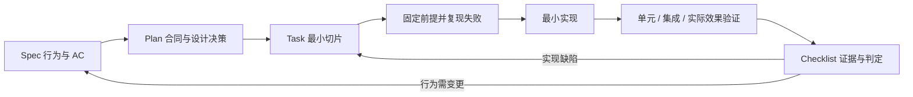

# 意图识别、路由与纠错 Plan v1

指定 Agent 草稿修订采用独立 review_brief 步骤与 Coordinator 定稿依赖，名单从结构化用户请求解析，不能交给模型重选。基础派生与未启用运行门已加入；受理、执行、逐目标恢复和双端入口仍在实施，详见[专项设计](intent-directed-brief-revision-design-v1.md)。

草稿失败恢复增量：同一不可变步骤保存新 operation ID 和只追加失败快照收据，显式 CAS 请求才新开有限预算；Runtime 以当前 operation ID 拒绝旧准备。查询复用版本校验但不领取，已保存结果继续原发布恢复。共享双端入口保存未知请求并原样核对。详见[恢复记录](../quality/intent-recognition-correction-runs/2026-10-19-sdd-development/brief-retry-report.md)，连接等待倒计时反馈、指派修订和专业执行仍待完善。

结构化草稿修订增量：严格版本请求经同一消息管线受理和分类，只有绑定原任务的无效果计划才能提交修改说明与逐题回答，并派生替代草稿。问答以 typed Decision 保存，新稿排除已回答问题；旧卡在新稿发布时解决，暂停保持。共享客户端冻结未知结果原请求，指定生成 Agent 仍显式阻止，完整指派修订/失败生成恢复/专业执行待续。详见[修订记录](../quality/intent-recognition-correction-runs/2026-10-19-sdd-development/brief-revision-report.md)。

纠错到 Brief 增量：无执行效果纠错激活时，若当前任务正在确认/修订草稿，则在同一不可变计划中派生带 replacesBrief 的 prepare_brief。新草稿以 supersedesBriefId 关联历史；暂停只 queued，恢复才开始预算。生成取新版本 source/snapshot，旧确认和迟到结果受版本守卫。约束分类沿替换/继承关系投影，详见[记录](../quality/intent-recognition-correction-runs/2026-10-19-sdd-development/brief-correction-report.md)。完整修订表单和专业执行仍待接通。

版本化 Brief 确认增量：严格请求绑定原确认卡、Brief/意图版本和 epoch；事务重验不可变步骤、Decision hash、要求版本及纠错屏障，原子保存确认收据、Decision、Brief 与 Outbox。等价双端确认单次生效，暂停保持关闭准入；确认不授予执行权限。共享客户端冻结未知响应请求，旧工作流选择继续拒绝新合同。详见[确认记录](../quality/intent-recognition-correction-runs/2026-10-19-sdd-development/brief-confirmation-report.md)，修订与版本化业务执行仍待完成。

首轮 Brief 执行增量：新合同单段 create_initial_work_item、无执行效果且处于输入/讨论状态时，PlanCommit 在同一事务派生 prepare_brief 并保存 queued，提交后由持久化执行器处理。分类与草稿生成是各自有界操作，草稿总 2 次调用/最多 120 秒、一次修复由执行器持有，Generic 适配器不再内层修复。确认后业务仍须新版本化流程，旧确认/修订入口显式拒绝；相关/独立新任务及复杂 Brief 路径仍待接。实际 HTTP 与限制见[自动草稿记录](../quality/intent-recognition-correction-runs/2026-10-19-sdd-development/brief-executor-report.md)。

Brief 链路先建立事务基础，再接执行器：服务端从已绑定新 WorkItem 的创建步骤派生 prepare_brief，模型输出合同不增加该动作。派生步骤与父步骤同属不可变计划；仅允许无工具、无工作区能力的草稿生成，不能借空效果范围授权其他 phase。草稿、建议任务、确认卡与 Outbox 原子发布，建议任务仅为待确认提案；生成约束没有 Decision 依据时进入待确认问题。当前事务存储与守卫已有验证，尚未接入自动派发、确认后执行及旧缓存读取迁移，详见[事务基础记录](../quality/intent-recognition-correction-runs/2026-10-19-sdd-development/brief-store-report.md)。

指定 Agent 回答采用单段问题按目标展开独立 step：保留共同原文/证据与 segmentId，每个 step 只绑定一个目标、独立幂等键和有限执行预算；所有 step 与版本原子提交后派发。路由仅在全部回答完成时 applied，任一失败保留 failed，其他已完成回答不撤销。目标不可用明确失败，不替换为 Coordinator。该切片不开放多段 ordered_plan；实现和数据库/HTTP 范围见[指定回答记录](../quality/intent-recognition-correction-runs/2026-10-19-sdd-development/targeted-answer-report.md)。

服务端 Claude 分类增量采用独立 Worker 内的临时空目录、空原生工具、关闭自定义配置及单 turn；格式修复仍归持久化分类器。只开放 server_local 的 routing 合同，Codex/Bridge 和业务效果继续按未具备能力处理。完整 Runtime 实测与限制见[记录](../quality/intent-recognition-correction-runs/2026-10-19-sdd-development/claude-classifier-report.md)，不把 CLI 只读沙箱等同于无工具。

> 日期：2026-10-19。状态：实施中；阶段门按 Task/Checklist 的实际证据验收。
> 四件套：[Spec](../product/intent-recognition-correction-spec-v1.md) · [Plan](intent-recognition-correction-plan-v1.md) · [Task](../implementation/intent-recognition-correction-task-v1.md) · [Checklist](../quality/intent-recognition-correction-checklist-v1.md)。
> 技术细节：[系统开发设计](intent-recognition-correction-system-development-design-v1.md)；原始分组：[IR00–IR13](../implementation/intent-recognition-correction-development-v1.md)。

## 1. 计划目标与已确认边界

2026-10-20 多段澄清展示增量：PlanCommit 在原事件/Outbox 中保存完整只读诊断，Web/Desktop 显示全部段和依赖并核对当前路由版本。2–8 段仍整组等待澄清，不创建部分执行步骤，不能借旧关系确认接口选择执行子集。实现及范围见 [multi-segment-review-report](../quality/intent-recognition-correction-runs/2026-10-19-sdd-development/multi-segment-review-report.md)。复杂澄清提交和自动 ordered_plan 不因此启用。

2026-10-20 原消息识别恢复增量：通过严格的 retry-recognition API 接受用户显式请求，归档旧失败/预算并生成新的 recognitionOperationId，与 revision、回执和 Outbox 原子保存。Pipeline、分类租约、结果提交、Runtime 预约与启动前检查绑定该 ID，旧 worker/timer 不覆盖新操作。Web/Desktop 共享固定请求与未知响应核对流程；真实连接 circuit 不重置。证据见 [recognition-retry-report](../quality/intent-recognition-correction-runs/2026-10-19-sdd-development/recognition-retry-report.md)，属于 IR03/IR09/IR10/IR12 局部增量。

2026-10-20 首轮授权重校验增量：`create_initial_work_item` 可携带受限的单次隔离测试及同 runner 的报告效果。缺少授权时不创建任务或 Brief；授权更新不触发执行，用户显式点击后复用已保存的语义和原文，刷新上下文并重编译。原诊断计划、授权后的版本、首次 WorkItem、queued step、幂等回执、事件与 Outbox 同事务提交。仅接受权限/能力原因，语义歧义仍走澄清；暂停不恢复。具体证据见 [authorization-retry-report](../quality/intent-recognition-correction-runs/2026-10-19-sdd-development/authorization-retry-report.md)，不替代 IA03 的完整模型和环境矩阵。

把 Spec 的 20 项行为要求落实到现有模块和可验证增量。沿用已讨论方案，无需重新选择架构：同一 NestJS 进程、Context v2、服务端策略裁决、版本化纠错和现有持久化/恢复机制。正常识别一次模型调用，异常处理共享有限预算；明确命令不调用模型。

回答执行采用独立 response 准入，绑定已提交 answer step 和版本，保持 routing 仅作识别、business 保持原有暂停门禁。纯 answer 不访问工具；带 read_workspace 的回答须有独立工作区只读授权并通过实际 read_file/search_code 检查，不获得写入、命令或测试能力。response 不创建任务、不恢复会话；共享持久化 Runtime 调用上限与原子回复发布。细节见系统设计 4.3，实际入口与工作区类型以 IR05/IR06 的验证为准。

报告执行首个落点为隔离测试结果：同一单步骤可含 run_tests 和绑定同一 runner 的 write_artifact，但必须分别取得当前用户授权。执行容器仅获测试能力，报告由服务端根据持久化测试日志生成并事务发布；不向模型或容器开放写文件工具。报告保存失败重用原日志，不重跑测试；已发布报告不视为可丢弃 scratch，纠错必须保留历史事实并显式对账。此切片不等于任意报告、首轮评测、源码修改或子任务权限均已验收。

已完成的受限测试报告纳入纠错影响集合，验证完整历史计划、报告及执行证据后记录“报告保留”回执。若新的纠错计划明确重新测试并保存报告，将历史报告 ID 冻结到新 step，发布新报告时追加替代关系；不覆盖旧报告，也不把已完成测试误记为撤销。新执行依旧使用当前权限，不因为旧报告存在而获得授权。

四件套初版为文档阶段，此后用户已授权实施。实现基线与增量证据见 Task/Checklist 的 SDD-2026-10-19 记录，保留已有 dirty 改动；发布环境和数值性能预算是发布前配置项，不在本计划中假定已获生产授权。

## 2. 当前代码证据与改造落点

以下路径相对仓库根目录；`server/modules/` 在本表中代表 `apps/server/src/modules/`。

| 当前事实 | 改造位置 | 目标 |
| --- | --- | --- |
| 首轮 recognizeTask 后即创建 WorkItem/启动 Brief | `server/modules/sessions/sessions.service.ts`、`message-routing/message-ingress.service.ts` | 先接入路由，提交计划后启动；支持无 WorkItem 问答 |
| SemanticIntentRouter 内含重复命令逻辑和局部校验 | `intent-recognition/semantic-intent-router.service.ts`、`message-routing/command-state-resolver.service.ts` | 命令状态统一，策略抽成共享纯校验 |
| clarify 已 ROUTED 时直接返回，confirmationId 可选 | `sessions/sessions.service.ts`、`sessions.controller.ts`、`context-management/context-management.service.ts` | 同事务绑定版本、选择和收据；反选择 409 |
| writeMode 来自 requiresCodeChanges，CLI 测试也依赖 writeMode | `runtime-routing/invocation-resolver.service.ts`、`runtimes/cli-tool-authority.ts`、`tools/tool-authority-resolver.service.ts` | effectScope 驱动实际权限，测试与源码写入解耦 |
| 已有 supersedesDecisionId，但普通路由纠正未连接实际替换 | `context-management/context-management.service.ts` | 抽取原子 draft mutation，接入旧 revision 校验和本地继承覆盖 |
| 已有 LogicalOperation、租约、Outbox、File/关系式存储 | `runtimes/logical-operation-store.ts`、`persistence/`、`execution/`、`recovery/` | 扩展统一预算、屏障和版本绑定，复用基础设施 |
| 双端共享 Session store，分别消费确认交互 | `apps/web/src/stores/session.ts`、Web/Desktop SessionWorkspace、ConfirmationCard | 绑定请求、冲突反馈、接收与生效状态，防乱序倒退 |

基线依据是原设计和评测时工作区，并非仅提交 SHA。实施 IR00 时对上述入口重新检索，不因有文档就假定行号/函数实现未变。

## 3. SDD 执行闭环



不为无关低影响文档修改编写业务测试。进入业务实现后，对本次涉及并发、权限、重试和持久化的关键行为先建立有效失败回归；不能用与实现同构的断言代替外部效果验证。每个切片可独立检查，未通过对应门不得把依赖任务记完成。

## 4. 关键设计决策

| 决策 | 实施规则 | 对应规格 |
| --- | --- | --- |
| D01 统一入口 | 首轮/普通消息/用户选择/纠错统一持久化、共享校验；保留确定性控制优先级 | IRC-R01、IRC-R05、IRC-R07 |
| D02 模型只生成提案 | 新 kind=intent_understanding、schemaVersion=1.0；保留 Context v2；严格分段和证据字段 | IRC-R02、IRC-R20 |
| D03 服务端编译动作 | 新 IntentPolicy 与 RoutePlanCompiler；有限动作替代宽泛 continue_active_work_item，不解析自由文本派发 | IRC-R04、IRC-R06、IRC-R14 |
| D04 权限独立 | validUserGrant 与阶段/工具/工作区/Runtime 能力求交并减去禁止项；传到实际 Adapter/工具/写回层 | IRC-R03 |
| D05 澄清与纠错分开 | 澄清保存不可冲突的选择收据；纠错追加版本，先冻结明确目标，再校验/停止/对账/激活 | IRC-R08、IRC-R09 |
| D06 四种版本各司其职 | routingRevision 用 CAS；intentRevision 用计划；requirementRevision 用有效约束；executionEpoch 用派发屏障 | IRC-R09、IRC-R10、IRC-R11 |
| D07 统一持久化预算 | 默认 2 次 invocation/120 秒；格式修复≤1、快照重建≤1，共享总预算；未知效果先对账 | IRC-R12 |
| D08 原子性和恢复 | existing mutation/事务锁 + File 原子写 + PostgreSQL 关系事务 + Outbox，不持锁等待网络 | IRC-R13 |
| D09 诚实状态与证据 | 新消息级 BLOCKED 区别语义澄清；ROUTED 只表示计划提交；未知用量明确未知 | IRC-R15、IRC-R16、IRC-R17 |
| D10 兼容与收敛 | 先读兼容和安全基线，后开新写入；shadow 无效果，回滚不恢复危险旧兜底 | IRC-R18、IRC-R19 |

完整字段、动作允许矩阵和错误码沿用系统开发设计第 4–11 节，实施不能省略其负向条件。本 Plan 组织开发依赖，不重新发明一套合同。

## 5. 入口、事务与模块边界

### 5.1 模块调用

```text
Sessions/API
  → MessageIngress（消息/引用/幂等）
  → DeterministicCommandGuard + CommandStateResolver 或 SemanticIntentRouter
  → IntentPolicy + RoutePlanCompiler + ExecutionScopeResolver
  → ContextManagement 原子计划提交 / IntentCorrection 版本流程
  → Dispatcher / InvocationResolver / ToolAuthority
  → Runtime / Workflow / ChangeSet
  → 版本再校验 / 结果收据 / Outbox
```

IntentRecognitionModule 不调用业务写入；MessageRoutingModule 放策略、编译和纠错；由 Sessions 组合服务，避免反向依赖 SessionsService。专业 Coordinator 消费已裁决计划，逐步退出重复分类职责。

### 5.2 必须先固定的接口

- 模型输出：IntentUnderstanding/IntentSegment，包含目标、原文证据、效果、禁止项、依赖、缺失与纠正目标。
- 服务端输出：ValidatedRoutePlan/Step，含计划、段/步骤 ID、授权范围、前置条件、版本绑定与幂等键。
- 共享快照：首轮标识、合法候选、确认/失败检查点、授权/禁止和效果摘要、遗漏标记；指纹只包含业务相关事实。
- 澄清 API：confirmationId、expectedRoutingRevision、choice、idempotencyKey；canonical payload 冲突有稳定错误码。
- 纠错 API：instruction、expectedRoutingRevision、明确目标与可选旧 Decision revision；202 表示接受，不表示生效。
- 消息状态：新增 BLOCKED，更新轮询、队列、恢复及双端展示；不新增 Session 的“识别中”状态。
- 事件：plan committed、blocked、correction requested/applied/reconciliation 和 stale result；版本与业务状态同事务。

### 5.3 原子边界

| 提交点 | 必须共同提交 | 事务外动作 |
| --- | --- | --- |
| Ingress | 输入、routing、唯一消息键、事件 | 模型调用 |
| Clarify | 版本/绑定、resolution receipt、计划和业务变化、Outbox | 对用户返回/事件发送 |
| Accept correction | correction receipt、输入、route/WorkItem hold、epoch、旧排队失效、Outbox | 停止旧 Runtime、重识别 |
| Activate correction | 停止/效果已核对证明、旧约束 supersede、新计划/版本、适用 hold 释放、Outbox | 后续派发 |
| Publish result | binding 再验、effect receipt、投影/产物可见性、下一步意图、Outbox | Outbox 发布 |

File/PostgreSQL 都必须具备这些业务边界。第一次安全修复允许先在既有 routing 保存澄清 resolution 字段，后续按确定性迁移转为独立实体；过渡期不能出现两个相互竞争的选择事实源。

## 6. 开发批次与退出门

| 批次 | 原任务 | 交付内容 | 退出门 |
| --- | --- | --- | --- |
| B0 基线 | IR00 | 版本/dirty diff/原题/判分前提；确认已知失败可复现 | G0 基线齐备，历史与新验收分开 |
| B1 安全修复 | IR01–IR03 | 共享硬校验、原子澄清、失败分流/预算 | G1 V15/16/17、H04/05/07、V05 等映射回归及已有命令回归通过 |
| B2 统一语义 | IR04–IR06，IR10 对应消费部分 | 新合同、效果权限、首轮统一、受限识别、多意图澄清 | G2 只读/评测/首轮/双端 blocked 实际效果通过，默认不启用 ordered_plan |
| B3 版本纠错 | IR07–IR10 | 版本存储、纠错接口、Decision 作废、执行/回调守卫和客户端 | G3 File/PostgreSQL 并发/故障/真实纠错通过 |
| B3-O 可选有序计划 | IR11 | 多段依赖与跨版本效果复用 | G3-O IF10/IF11 真实通过才启用 ordered_plan |
| B4 质量与收敛 | IR12–IR13 | 独立评测、shadow/灰度、兼容回滚、旧路径退出 | G4 质量/配置/证据齐备；G5 具体部署授权和放量证据齐备 |

阶段完成不表示全部需求完成。IR10 可随合同和纠错分两次接入，但最终双端验收由同一 Checklist 记录。IR11 未启用不阻断 clarify 模式交付，必须明确受限范围。

### 6.1 依赖关系

```text
IR00 → IR01 / IR02
IR01 → IR03 / IR04
IR04 → IR05
IR03 + IR05 → IR06
IR02 + IR04 → IR07
IR07 → IR08
IR05 + IR08 → IR09
IR06 + IR08 → IR10（统一最终验收）
IR09 → IR11（可选）
IR09 + IR10 + 已启用的 IR11 → IR12 → IR13
```

依赖图用于安排实现顺序，不要求启动多 Agent。不在共享高耦合文件上未经协调并发修改。

## 7. Spec—任务—验证追踪

| 需求 / AC | 主任务 | 必须落入 Checklist 的验证 |
| --- | --- | --- |
| IRC-R01 / IRC-AC01 | IR06、IR10 | IA01–IA03、IF02 |
| IRC-R02 / IRC-AC02 | IR04 | IA14、IA18、IA21、IF12 |
| IRC-R03 / IRC-AC03 | IR05、IR09 | IA01–IA05、IA24、IF14 |
| IRC-R04 / IRC-AC04 | IR04、IR06 | IA05–IA10 |
| IRC-R05 / IRC-AC05 | IR01、IR06 | IA11–IA16、IF16 |
| IRC-R06 / IRC-AC06 | IR01、IR05 | IA17–IA22 |
| IRC-R07 / IRC-AC07 | IR06、IR09 | IA23、IC10 |
| IRC-R08 / IRC-AC08 | IR02、IR10 | IC01–IC07 |
| IRC-R09 / IRC-AC09 | IR07、IR08、IR10 | IC08–IC11、IC17–IC18 |
| IRC-R10 / IRC-AC10 | IR07、IR08 | IC12–IC15 |
| IRC-R11 / IRC-AC11 | IR07、IR09 | IC16、IF07、IF09 |
| IRC-R12 / IRC-AC12 | IR03、IR06 | IF01–IF05、IF16 |
| IRC-R13 / IRC-AC13 | IR02、IR07、IR09、IR12 | IC03、IC14、IF05–IF09 |
| IRC-R14 / IRC-AC14 | IR04、IR11 | IA14、IF10–IF13 |
| IRC-R15 / IRC-AC15 | IR10 | 双端 IC02、IC05–IC06、IC09–IC10、IF06 |
| IRC-R16 / IRC-AC16 | IR03、IR12 | 追踪/未知用量/敏感信息审计 |
| IRC-R17 / IRC-AC17 | IR00、IR12 | 独立封存集、原 339 项与启用范围全安全集 |
| IRC-R18 / IRC-AC18 | IR07、IR13 | 迁移副本、旧数据/客户端/混合 worker、IF15 |
| IRC-R19 / IRC-AC19 | IR13 | shadow 无副作用、回滚演练、路径收敛 |
| IRC-R20 / IRC-AC20 | IR01、IR04、IR05、IR06 | IA20–IA24、IF09、IF14 |

每项测试可以覆盖多项 AC，但报告不能将同一结果重复累加成样本量。具体题目和预期保持原验收矩阵为引用源。

## 8. 验证策略

1. 纯函数/合同：动作组合、状态守卫、输出 Schema、否定范围、授权求交和依赖图；用输入/输出及拒绝原因验证。
2. 服务集成：真实 ingress/route apply/clarify/correction，观察 WorkItem、Ledger、收据与 Outbox；不能只断言 mock 被调用。
3. Runtime/权限：验证有效工具/sandbox、实际文件 hash、测试 scratch、产物和子任务范围；不能靠 Prompt 文本证明只读。
4. 双端 HTTP/UI：真实确认卡、重复/反选择、过期、刷新与事件乱序，检查“已接收”与“已生效”的区别。
5. 故障恢复：reserve/commit/publish 边界注入崩溃和迟到回调，File/PostgreSQL 对照，效果未知不得自动重放。
6. 语义统计：独立 500+ 封存题、双人标注、3 次运行与置信区间；真实模型分类与专业执行 E2E 分开报告。

现有标准命令如下，实施阶段按改动运行对应最小集合，阶段合并前完成全套要求：

```powershell
npm run typecheck
npm run test
npm run test:harness
npm run build
npm run test:e2e:phase-2a-routing
npm run test:e2e:phase-6-fault-matrix
npm run test:e2e:phase-6-crash-restart
npm run test:e2e:phase-6-postgres
npm run test:e2e:phase-6-backend-parity
```

新增专项脚本由对应 Task 创建后记录实际命令，不把规划的文件名说成现有命令。本轮仅文档验证，不运行上述产品检查或付费模型评测。

## 9. 迁移、发布与风险控制

先部署存储和读兼容，后部署服务/worker，再部署双客户端，最后开启新合同。保留现有 INTENT_ROUTING_MODE；新语义/多段开关按详细设计落地，每条 routing 保存配置快照。历史缺权限信息保持 unknown，不恢复旧 Context 管线。

| 风险 | 控制与验证 |
| --- | --- |
| 首轮及 source-ready/恢复入口提前启动 | 全部入口要求已提交计划；IR06 检索调用点并验证 |
| CLI 测试仍依赖源码 writeMode | IR05 同步底层 authority、Runtime/Bridge 及真实效果 |
| 纠错模型较慢时旧任务继续派发 | 接收事务先写 hold/epoch，失败不自动释放 |
| 版本修正引入新 key 重做已完成步骤 | IR11 必须关联 reusedEffectIds，未实现保持 clarify |
| 新旧 worker 混合破坏屏障 | 能力/合同隔离；不兼容 worker 不能接管；回滚不降至无版本版本 |
| 历史失败题变为“全绿”但实际未修 | 原结果只读留存，新 oracle 预先版本化；看实际效果和独立题库 |

允许改动范围按 Task 指定模块及相关合同/测试/文档。禁止顺带重构、删除用户数据、覆盖 dirty 修改、修改生产模型连接或未经授权发布。遇到规格冲突先更新设计，不将不确定性隐藏成默认执行。

当前入口迁移采用新增 INTENT_UNDERSTANDING_ENABLED 开关与既有 enforce cohort 共同准入。Session 持久化 intentContractVersion 后不随配置回滚退回旧链；普通新合同消息复用新入口，旧恢复/bootstrap 不预建任务或 Brief。当前仅验证任务上下文与纯回答，实际业务执行和特殊入口需完成 IR06 后方可放量。验证范围见[入口开发记录](../quality/intent-recognition-correction-runs/2026-10-19-sdd-development/semantic-ingress-report.md)。

读取授权增量：通过版本 CAS API 撤销/重新签发只读 grant；来源就绪采用事务发布绑定并调度原消息。旧 grant 不从历史计划重新继承。实现及边界见[开发记录](../quality/intent-recognition-correction-runs/2026-10-19-sdd-development/workspace-authority-report.md)，仍需授权 UI、真实 GitHub 与本机读取验证。

读取授权界面采用共享组件和 sessionId/dataEpoch 绑定状态。GET/POST 响应增加会话身份与 revision，客户端严格校验并防止迟到读取覆盖。网络未知结果只重试原请求；409 刷新并等待新的人类动作。细节与验证边界见[报告](../quality/intent-recognition-correction-runs/2026-10-19-sdd-development/workspace-authority-ui-report.md)。

隔离测试实现顺序明确为：固定 runner 执行器及真实隔离证据 → 用户 grant/runner 绑定 → 版本化计划派发和停止对账 → CLI/双端矩阵。当前第一层已落地，保持新合同 run_tests 未授权时 blocked，详见[记录](../quality/intent-recognition-correction-runs/2026-10-19-sdd-development/isolated-tests-report.md)。

在开放授权和派发前，先补齐隔离 runner 的持久化对账：预约、容器身份、快照和结果进入现有 LogicalOperation；启动/续期重验版本，恢复仅清理过期执行并保留中断，不自动重跑。此依赖提前实现，功能范围不缩减；下一步仍是独立 grant/runner 绑定和版本计划派发。证据与剩余边界见[恢复记录](../quality/intent-recognition-correction-runs/2026-10-19-sdd-development/isolated-tests-recovery-report.md)。

测试授权与 runner 绑定现通过独立 CAS API 实现，绑定服务端固定镜像/脚本/工作区，快照包含候选和有效授权，提交/执行阶段读取当前 grant。配置候选不代表 Runtime 可执行；下一依赖为授权界面、版本计划派发及运行中撤销/结果事务，详见[授权记录](../quality/intent-recognition-correction-runs/2026-10-19-sdd-development/test-authority-report.md)。

共享测试授权界面已接 Web/Desktop。未知提交在当前标签页 sessionStorage 中保存原身份，刷新后只能经用户点击重试；冲突刷新而不自动重发。版本计划派发和运行中撤销/结果事务仍为下一依赖，详见[界面记录](../quality/intent-recognition-correction-runs/2026-10-19-sdd-development/test-authority-ui-report.md)。

版本测试派发前新增实际启动绑定检查：授权 API 的资源引用必须落实到 runner 实际 image/script/source root，并保存到物理执行日志，不能仅验证 grant ID。预约、create/start 前和续期均复核运行步骤及当前授权，已撤销执行仍可清理和记录审计。自动派发继续关闭，后续仍需贯通 Runtime/Tool 独立测试授权、定向取消与结果发布事务；证据见[记录](../quality/intent-recognition-correction-runs/2026-10-19-sdd-development/test-runner-binding-report.md)。

单测试计划派发现已接通：专用 cap-isolated-test 候选只对应 run_test，真正授权在持久化步骤/调用核验中完成；测试 grant 不映射为 command 或 write。计划保持单次物理调用，结束后从已确认停止的 journal 事务发布结果，恢复不隐式重跑。API 授权变更通知当前实例取消旧调用，其他实例由续期防线处理。下一依赖是执行型纠错和更完整的业务/多段派发、环境验证，详见[报告](../quality/intent-recognition-correction-runs/2026-10-19-sdd-development/test-dispatch-report.md)。
