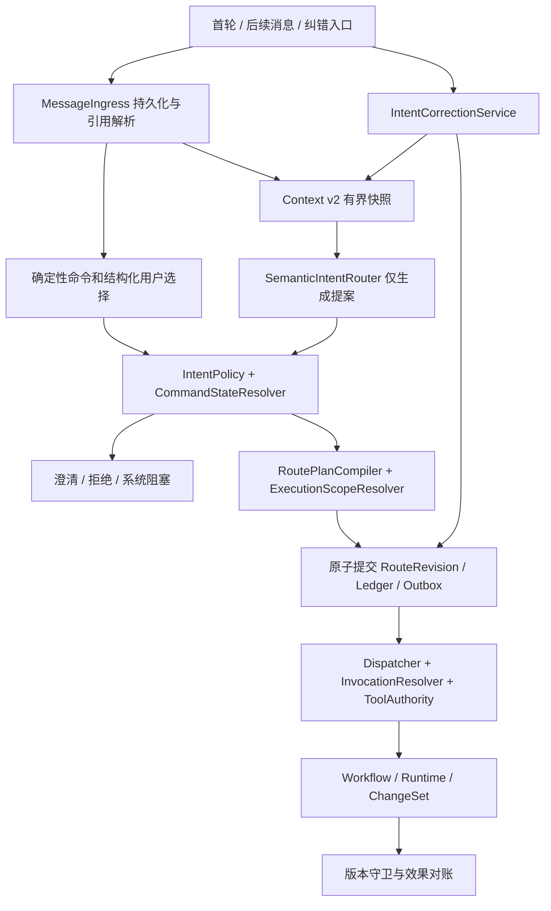

# 意图识别、执行授权与版本化纠错系统开发设计 v1

2026-10-20 纠错后的草稿更新：prepare_brief 增加服务器绑定的 replacesBrief，当前待确认/修订任务的无效果纠错在激活事务派生该步骤；旧稿只保留历史，新稿记录 supersedesBriefId。生成阶段使用新 IntentRouteRevision 的 sourceEventId/snapshot，不能读原路由旧消息。领取/保存/发布重验旧稿、版本及全部执行守卫。暂停不启动预算，恢复后生成。实际范围见[报告](../quality/intent-recognition-correction-runs/2026-10-19-sdd-development/brief-correction-report.md)，此前基础段落为历史实现状态。

Brief 事务基础（2026-10-20）：prepare_brief 是服务端派生的 ValidatedRouteStep.action，不是 intent_understanding 允许的模型动作。父步骤须为已绑定 WorkItem 的创建动作且无执行效果；父步骤完成后，派生步骤持有独立 step/operation/租约和版本绑定。Runtime 配置只允许 Generic LLM/mock、task_brief 1.0、无工具/工作区能力/CLI resume。结果先保存到 step.processing.briefResult，之后原子写 Brief、建议任务、确认卡、Outbox 和当前 Brief 状态，失败可补发。Brief.intentBinding 保存来源；该草稿不授权建议任务执行，也不隐式写文件。生成约束不覆盖 confirmed Decision，未确认部分进入 openQuestions。当前只有存储/派生 helper/守卫，自动派发、确认流程和端到端入口仍待接；不得把夹具中的派生步骤当作生产入口已完成。证据见[事务基础记录](../quality/intent-recognition-correction-runs/2026-10-19-sdd-development/brief-store-report.md)。

实施增量（2026-10-20）：首轮 `create_initial_work_item` 已支持受限单测试及同 runner 报告。`IntentAuthorizationRetryService` 为缺权限的原请求提供显式重校验，先从当前持久化会话范围刷新事实，再保留原语义、引用、效果及原文建立快照。PlanCommit 在同事务重验 owner/epoch/generation/CAS/源消息/快照/当前授权；原非执行版本、新 validated 版本、首次 WorkItem、queued step、回执和 Outbox 一起保存。仅成功回执可重放，重放不重复建任务或模型分类；调用方不能提交新语义或计划。暂停、歧义、已执行、shadow、纠错屏障或目标变化均不能借此放行。Web/Desktop 共享面板及按原消息绑定的未知结果恢复。详细证据见 [首轮授权重校验报告](../quality/intent-recognition-correction-runs/2026-10-19-sdd-development/authorization-retry-report.md)。以下目标设计尚未全部实施，不能据此推定所有阶段已完成。

> 日期：2026-10-19（Asia/Shanghai）
> 状态：开发设计，尚未实施；文中新增类型、服务、接口、字段和指标均为目标方案。
> 输入：[实测报告](../quality/intent-evaluation-2026-10-19/README.md)、本轮已讨论的架构改造方案，以及当前工作区源码。
> 配套：[实施任务](../implementation/intent-recognition-correction-development-v1.md)、[验收矩阵](../quality/intent-recognition-correction-acceptance-v1.md)。

## 1. 设计结论与范围

### 原消息识别恢复补充（2026-10-20）

识别未形成可用语义且因 auth/config/transient/schema/budget 阻塞时，`IntentRecognitionRetryService` 负责原子接收显式重试。路由保存当前 recognitionOperationId 和 recognitionRetryReceipts；回执冻结旧 operation、attemptLog、deadline、提案与失败原因。新操作只复用原 user_message，不授予效果权限；原 LogicalOperation 永久保留。事务检查 owner、epoch/generation、CAS、停止状态和旧 active invocation，随后保存路由/回执/事件/Outbox，再调度同一新操作。

Pipeline 的 in-flight/timer、分类 claim 和所有回写均以 recognitionOperationId 隔离；LogicalOperation reserve 与 Runtime 异步准备后再次检查当前 ID。重复 POST 可以恢复尚未完成的同一操作；旧回执重放不会切回旧 ID。已受理恢复仍受原绝对 deadline 和最多两次调用/一次结构修复约束；provider circuit 原样生效。合法语义缺权限、语义澄清及已生效意图纠错分别沿用授权重校验、澄清和 corrections，不混用此入口。

在现有 NestJS 进程和 Context Pipeline v2 内，建立统一链路：**消息接入 → 确定性控制/语义理解 → 服务端策略裁决 → 原子提交执行计划 → 受权限和版本约束的执行**。首轮、后续消息、澄清和纠错共享裁决规则。模型只提出理解结果，不能自行授予权限或直接改变业务状态。

本设计补充已有 [WorkItem 系统设计](intent-context-workitem-system-agent-system-design-v1.md) 和 [精确命令专项设计](exact-command-first-intent-routing-system-development-design-v1.md)。精确命令专项的 Phase 1–4 已实现，Phase 5 单轨收敛仍待完成；本设计不将这些已有能力重复列为新建功能。关于新语义合同、纠错、授权和回滚，后续实现以本文为专项依据，其余沿用现有 Context v2、工作区隔离和执行终止合同。

### 1.1 Intent Contract

| 项目 | 本次设计约定 |
| --- | --- |
| 目标 | 修复评测已复现的偏差，使错误理解能够被拦截、纠正、追踪，并限制错误理解带来的实际执行效果 |
| 范围 | 首轮与后续识别、命令、需求关系、权限、澄清、用户纠错、重试、执行版本、Web/Desktop 反馈、持久化与评测 |
| 实现边界 | 同一后端进程；复用 WorkItem、Decision Ledger、LogicalOperation、租约、Outbox、Tool Authority 和 Runtime Adapter |
| 非目标 | 新建微服务、再建 Context Pipeline、训练/微调模型、把 Harness 产品化、重写专业 Agent、切换生产模型 |
| 兼容 | 历史记录可读；新增合同有版本；File/PostgreSQL 业务语义一致；旧客户端不能绕过新校验 |
| 验收 | 已知问题进入回归；真实执行效果满足权限与版本约束；独立标注评测及灰度门通过后收敛旧链路 |
| 本轮交付 | 系统设计、开发任务和验收标准；不代表已修改或验证产品实现 |

本轮需求落点明确，采用上述保守兼容边界即可完成设计，无阻塞性产品问题。具体部署环境、正式流量比例和性能预算在发布前核实，不影响合同与模块开发。预计工期应在开发任务评审后估算，不把尚未验证的性能目标写成承诺。

### 1.2 方案取舍

| 选项 | 判断 |
| --- | --- |
| 只改 Prompt/追加正则 | 能改善局部标签，不能解决相反选择并发、授权耦合、旧执行回调和约束作废；不采用为主方案 |
| 统一语义合同 + 服务端计划编译 + 版本化纠错 | 复用当前资产，直接覆盖已复现问题；采用 |
| 独立识别微服务/第二模型逐条复核 | 增加部署、延迟和一致性成本；现有证据不足以支持；本期不采用 |

## 2. 评测依据与改造追踪

基线提交为 `bb3d278db3e734b643abef015bdd2190ef578638`，评测包括当时的未提交修改；本设计核对的是当前工作区。实际开发前重新记录 diff 和测试基线，不覆盖已有修改。

| 证据 | 已知事实及限制 | 设计响应 |
| --- | --- | --- |
| T10/11/12/13/15/17/19 | 17 道预期不改代码的诊断题中，7 道错误标记 requiresCodeChanges；未实际写代码 | 拆开语义、请求效果、禁止事项和执行授权 |
| F02/03/04/07 | 否定新任务/“另外补充”误分；异常退回规则存在实际入口 | 模型故障不再用关键词产生可执行业务决定 |
| V15/V16 | 模型低风险取消、关系/动作/上下文冲突可通过校验；未实际取消 | 服务端风险计算和允许组合表 |
| V17 | 内部路由与真实命令入口状态标准不同；真实入口已阻止 COMPLETED 继续 | 共享 CommandStateResolver 与动作状态守卫 |
| V18 | modelConfidence=0.1 仍可得到 serverConfidence=1 | 删除分数授权语义，分开校验结果与语义评测指标 |
| H04/H07 | 顺序/并发相反选择均可成功返回旧结果，未重复创建任务 | 澄清选择原子绑定；相反选择 409；独立纠错接口 |
| H05 | confirmationId 当前可选，未验证目标 | 新合同强制绑定确认对象；属于加强约束，不宣称现有鉴权漏洞 |
| V05 | Schema 修复重试没有具体前次错误反馈 | 带错误路径的单次修复，共享总预算 |
| L11 legacy | 两个目标被压成单条 continuation，额外动作藏在文本指令里 | 分段合同、依赖与逐段效果记录 |
| L17/L20/L20B | 安全拒绝、缺失旧决定时澄清合理；补齐前提后分类通过 | Gold 预先允许合理拒绝/澄清；实际作废决定另测 |

已有 339 项相关回归通过、新编诊断 52/70、真实 Codex 两条链路分别 18/20 与 19/20、HTTP 纠错 4/7。它们是不同层的结果，不能合并为线上准确率。Codex 是隔离评测连接，原项目连接 401；原生产模型质量和 PostgreSQL 场景仍未被此次评测证明。

## 3. 总体架构和模块职责



| 组件 | 落点与调整 | 唯一职责 |
| --- | --- | --- |
| MessageIngressService | 扩展 `modules/message-routing/message-ingress.service.ts` | 持久化首轮/后续输入、幂等、解析 @/reply/attachment；不先生成“可执行”旧 handlingPlan |
| DeterministicCommandGuard、CommandStateResolver | 复用现有实现 | 精确命令识别和状态裁决；内部分类路径移除重复状态规则 |
| SemanticIntentRouterService | 改造 `modules/intent-recognition/semantic-intent-router.service.ts` | 生成结构化语义提案；无工具、无业务写入、无权限授予 |
| IntentPolicyService | 新增于 `modules/message-routing/` | 纯策略校验：引用、关系、动作、风险、否定、目标、状态、确认绑定 |
| RoutePlanCompilerService | 新增于 `modules/message-routing/` | 将合法提案编译为有限动作集合；明确哪些步骤仅记录、哪些可派发 |
| ExecutionScopeResolverService | 新增于 `modules/runtime-routing/` | 把用户授权范围与阶段、工具、工作区和 Runtime 能力求交 |
| IntentCorrectionService | 新增于 `modules/message-routing/` | 接受纠错、创建版本、冻结受影响派发、组织旧效果对账 |
| ContextManagementService | 扩展现有原子 mutation | 提交计划、版本、Decision 作废/新增、投影、事件及 Outbox |
| RouteApplicationService | 改为消费服务端 ValidatedRoutePlan | 应用有限命令；不能信任调用者自行构造的 safeToApply=true |
| SessionsService / Orchestrator | 入口编排 / 专业规划 | Sessions 调统一管线；Coordinator 只消费已裁决计划，不能再次自由分类或从说明文本提取额外动作 |
| Runtime / Execution / Recovery | 扩展版本绑定、复用生命周期 | 派发前和结果发布前校验；有限重试、停止确认、恢复和对账 |

新增服务不新建互相引用的 NestJS 模块。`MessageRoutingModule` 负责策略/计划/纠错，`IntentRecognitionModule` 负责模型提案；由 Sessions 层编排两者。策略函数只接收快照数据，不能依赖 SessionsService。控制动作沿用 CommandApplication 的控制端口，避免依赖环。

## 4. 统一消息入口

### 4.1 接入顺序

1. 认证并校验 Session/dataEpoch；解析 `clientMessageId`、@、replyTo、attachment、明确目标。
2. 在接入事务保存消息、路由记录、处理状态和 Outbox；重复消息返回同一记录。
3. Runtime 切换、明确确认卡回复和精确命令走已有确定性解析器，再进入共享策略与状态校验。
4. 普通消息构造 Context v2 快照；模型输出提案；服务端裁决为 `applicable / needs_clarification / rejected / blocked`。
5. 合法计划在事务内重验快照和版本，提交后才允许启动 Brief、恢复工作流或专业派发。
6. 结构化选择和精确命令跳过模型，但不能跳过服务端校验。自然语言正文不能伪装为已认证的结构化操作。

模型调用失败不等于用户表达有歧义：`blocked` 展示连接/配置恢复，`needs_clarification` 才要求用户补充语义。不能把 401 包装成“请确认继续还是新任务”。

### 4.2 首轮接入的具体改造

当前 `SessionsService.create()` 调 `recognizeTask()`，创建初始 WorkItem 后立即 `generateBriefInBackground()`。目标流程如下：

- 创建 Session 外壳、生命周期、首条消息和 routing，保留现有 API 返回的 `session/firstEvent`，追加 routing 引用。
- Session 可暂沿用当前讨论状态；新增消息级 processing 展示优先于阶段展示。所有自动启动入口同时检查“已有提交计划和允许的派发步骤”，不能只检查 SessionStatus。
- 将 `ensureInitialWorkItem()` 从无条件接入移动到计划提交。普通问答允许 `workItemId` 为空；项目级问答可读取已绑定工作区，但不能因此开始专业实现。
- 明确任务编译为 `create_initial_work_item`，然后按效果范围规划 Brief/分析/执行；一个提交只创建一个初始任务。
- 删除首轮 `requiresCodeChanges` 对写权限的直接影响；保留旧字段作为兼容展示投影。
- `WAIT_SOURCE_PREPARATION` 等状态仍保留：路由可保存语义计划，依赖工作区的步骤等待 source ready，不能以识别成功绕过来源准备。
- 调整 ingress、route application 和恢复代码当前“必须有 active WorkItem”的假设；clarify/reject/answer 不应为了满足旧签名创建假任务。

### 4.3 暂停、失败、完成状态下的识别

当前 LogicalOperation 会拒绝暂停/完成等状态的 Runtime reserve。准入分为 `routing | response | business`（实现字段为 admissionClass），由服务端 phase 和持久化计划固定映射，不能由请求体或模型指定：

- `business` 保持现有生命周期门禁。
- `routing` 仅对应 `user_message_routing`：空工具集、禁止工作区命令与修改、有限预算；暂停/失败/完成且停止已确认时可识别消息，**不改变业务 admission、Session generation 或恢复状态**。
- `response` 仅对应 `user_message_response`，必须绑定当前已提交的 answer_in_chat step 和执行版本，无 Task、无写权限。纯 answer scope 仍为空工具；answer + read_workspace 仅在显式选定并由服务端校验的 server_local 工作区具有独立只读 grant 时允许 read_file/search_code，经 Agent 能力、阶段、Runtime、工具目录交集后执行。绑定路径/身份改变或 grant 撤销即失效；每次工具调用重新读取持久化版本、租约和 operation 停止状态，源码写入/命令/测试工具不能进入该目录。允许停止已确认的暂停/完成会话回应原问题，不开放 business。step 两次 Runtime invocation/120 秒和单次格式修复持久化；每次带工具 invocation 最多五轮 provider 请求、十二次工具调用，无适配器内额外传输重试。回复事件、Outbox 和完成状态原子提交，迟到/被纠正结果不得发布。当前 server_local 验证采用隔离兼容入口；GitHub source-ready、本地 Bridge 以及用户撤销界面仍需独立完成。
- Session 删除、epoch 不匹配、维护锁和停止未确认时仍不能启动新模型进程。可接收并保存消息/明确纠错的派发冻结，识别等待对账完成。
- 明确 pause/cancel 的确定性控制不依赖模型可用性；普通业务消息不能借 routing lane 执行工具。
- 旧队列中暂停期间先用规则生成的 handlingPlan 在恢复后必须重新识别；原标记不作为执行授权。

### 4.4 有界快照的扩展

继续使用 `IntentContextSnapshot`，在已有活动/候选 WorkItem、有效决定、最近消息、确认卡和失败信息之外补充：

- `entryKind`（initial/follow_up/correction）、明确的 routing/WorkItem/Decision 候选及各自 revision。
- 纠错候选的原消息、已采纳理解、current/effective intentRevision、相关执行阶段和效果收据摘要；只包含当前用户有权访问的同 Session 对象。
- 有效用户授权和禁止项摘要、原始授权事件引用、有效范围及撤销信息；不能让模型从旧 requiresCodeChanges 反推权限。
- 当前确认卡的绑定、允许选择和时效；结构化失败检查点 ID 与状态，替代仅凭自然语言猜测可恢复步骤。
- 裁剪/遗漏标记；候选中不含旧决定或 routing 时显式 missing，不能把快照截断当作“原约束不存在”。

快照输入按类型提供，目标匹配和引用校验在服务端完成。`businessFingerprint` 包含参与裁决的上述版本；纯进度/心跳不使快照失效。为保持有界输入，按 reply/明确 ID 优先选择，其次活动任务和有限近期候选；无法唯一召回则澄清，不为找目标加载全会话。缓存必须绑定 fingerprint 和访问范围。

### 4.5 消息处理状态

在现有 IntentRoutingStatus 中新增 `BLOCKED`，与 `CLARIFICATION_REQUIRED` 区别；同步轮询终止条件、队列恢复、事件和 UI 合同。不是给 SessionStatus 增加“识别中”。

```text
RECEIVED → SNAPSHOT_READY → CLASSIFYING → VALIDATING → APPLYING → ROUTED
                              │              │
                              ├→ PENDING_RETRY → 同 revision 的下一次有限尝试
                              └──────────────┼→ BLOCKED / CLARIFICATION_REQUIRED / REJECTED
```

`ROUTED` 只表示计划已提交，专业任务可能仍排队/执行；逐步结果在 IntentPlanStep 中记录。`BLOCKED` 不自动无限重投：显式重试、连接恢复后的受控操作或对账完成才能继续。clarify/纠错产生新 intentRevision，但路由 aggregate ID 不变；旧版本是否被替代通过版本关联表达，不覆盖原 payload。

## 5. 语义合同与执行合同

### 5.1 版本选择

保持 `ContextEnvelopeV2.version='v2'`。新建 Runtime 输出 kind `intent_understanding`，初版 `schemaVersion='1.0'`，业务标识 `semanticContractVersion='intent-understanding-v1'`。旧 `intent_routing_decision` 只供兼容读取/影子对照。

不能直接把新意图输出标为现有 Runtime `schemaVersion='2.0'`：当前 InvocationResolver 对 2.0 的支持限定于特定 task_execution_result。新增 kind 需同步 contract-types、output-contracts、registry、structured-output-instructions、导出、mock fixtures 和各 Runtime 能力合同；不修改所有输出类型的公共版本号。

### 5.2 模型输出：IntentUnderstanding

下面为领域结构示意；实现时用现有严格 Schema 定义全部字段、长度上限、nullable 策略和互斥规则，不接受 additionalProperties。

```ts
type IntentUnderstanding = {
  schemaVersion: '1.0';
  kind: 'intent_understanding';
  semanticContractVersion: 'intent-understanding-v1';
  segments: IntentSegment[]; // 1..8；超限返回缺失项，禁止截断后执行
  missingFields: string[];
  ambiguityReasons: string[];
  modelConfidence: number | null; // 仅诊断，绝不视为执行许可
};

type IntentSegment = {
  localKey: string; // 本次输出局部标识；服务端另分配持久化 segmentId
  dialogueAct: UserMessageIntent;
  goal: string;
  scopeRelation: 'initial_requirement' | 'session_context'
    | 'same_requirement' | 'related_new_requirement'
    | 'independent_new_requirement' | 'ambiguous';
  suggestedAction: IntentAction; // 第 6 节有限枚举
  target: {
    workItemId: string | null;
    decisionIds: string[];
    artifactIds: string[];
    agentIds: string[]; // 必须保留服务端解析的全部明确 @，不能增加非法成员
    confirmationId: string | null;
    correctionOfRoutingId: string | null;
  };
  correction: {
    supersedesDecisionId: string;
    expectedDecisionRevision: number;
    replacementText: string;
  } | null; // 仅对账本纠正使用；一般路由纠错由 correctionOfRoutingId 定位
  contextPolicy: ContextInheritancePolicy;
  requestedEffects: EffectRequest[];
  prohibitions: ScopedProhibition[];
  evidence: EvidenceRef[];
  dependencies: Array<{
    segmentKey: string;
    condition: 'route_committed' | 'execution_completed';
  }>;
};
```

| 子结构 | 必要字段与语义 |
| --- | --- |
| EvidenceRef | `refId/sourceEventId/start/end/quote`；start/end 为已保存原文的 UTF-16 区间；服务端验证 quote 相等；effect 的 evidenceRefs 引用本段 refId；不得使用模型生成文本证明用户授权 |
| EffectRequest | `kind/target/evidenceRefs`；kind 为 `answer/read_workspace/write_artifact/modify_source/run_tests/run_command/external_write`；目标使用解析后的资源引用或明确 unresolved，不接受模型拼出的任意路径 |
| ScopedProhibition | `effectKind/object/scope/evidenceRefs`；object 如 source、数据库结构、指定文件；scope 为本消息/WorkItem/明确后续范围，不能默认扩大为全局偏好 |
| target.decisionIds | 继承引用；纠正旧决定另须提交可核验的 supersede 目标和旧 revision，不以“选中了旧决定”代替“使其作废” |
| dependencies | 指向本次 localKey、不能自环或成环；“先完成 A 再执行 B”用 execution_completed；“先恢复 A 再创建 B”仅在语义明确时用 route_committed |

`initial_requirement` 只在首条明确任务且无既有目标时使用；`session_context` 用于无任务目标的问答/信息。新增这两个值是新合同扩展，不强塞进旧 RequirementScopeRelation。

原文引用能帮助审计，不能证明自然语言理解必然正确。服务端必须核对明确禁止语句、结构化用户选择、已有授权和目标；无法明确否定作用域或授权范围时澄清。历史消息、附件、Agent 回答和检索材料只能提供上下文，不能替用户授予新权限。

### 5.3 请求效果与实际授权

最终能力由服务端计算：

```text
effectiveCapabilities = validUserGrant(scope, revision)
  ∩ phaseAllowedCapabilities
  ∩ toolAuthority
  ∩ workspaceCapabilities
  ∩ runtimeEnforceableCapabilities
  − applicableProhibitions
```

`validUserGrant` 可以来自当前经过验证的明确请求，也可以来自仍有效、未撤销且目标范围匹配的历史授权；不要求每个低风险动作重新弹卡。模型的 requestedEffects、riskLevel、confidence 和 Agent Profile 都不能单独成为 grant。

| 用户表达 | 可用效果 | 不能推导出的授权 |
| --- | --- | --- |
| “解释这个报错，不要改代码” | 回答；必要的源码读取 | 源码修改、任意命令 |
| “评测当前系统，保存报告” | 隔离测试和指定报告产物写入 | 顺手修复源码、生产环境写入 |
| “修复登录缺陷，不要改数据库结构” | 在已有授权内修改源代码、测试 | 数据库 schema 变更；不能把此否定理解为禁止所有代码修改 |
| “把报告发给某人” | 形成外部发送候选 | 不能由“生成报告”自动派生发送；按现有外部操作授权策略处理 |
| “不要增加新功能，继续修复当前问题” | 记录限制并继续已授权修复 | 创建新增功能需求 |

`write_artifact` 与 `modify_source` 独立；禁止修改源码不妨碍用户明确要求的报告写入。`run_tests` 不等于开放 shell：测试须使用允许的 runner，并把临时写入限定在隔离 scratch/worktree；涉及生产数据库、网络写入或源码写回要另有匹配授权。

落实层次：InvocationResolver 选择能力可约束的 Runtime；ToolAuthority 在每次工具调用再核对 scope；本地 CLI 用支持的 sandbox/工具限制。若 Runtime 无法约束所需操作，不允许降级成不受约束执行。业务级禁止项如“不改表结构”还需由候选 ChangeSet/迁移检查和写回门验证；无法可靠验证则不自动写回。不能声称 Prompt 或 `canWrite=false` 本身能够阻止所有外部效果。

当前 `modules/runtimes/cli-tool-authority.ts` 的 canRunTests 也依赖 writeMode 非 none。因此必须将 CLI authority 的源码写入、产物写入、隔离测试分别从 effectScope 推导，并同步 Codex sandbox、Claude allowed tools 和本地 Bridge 的能力传递。不能只修改 Intent Schema 而让“只评测”仍需开启源码写模式。

派发的子任务只能继承或缩小父 scope。保留 `requiresCodeChanges` 兼容字段，但其值由有效计划投影而来，任何读取它决定权限的调用点都必须迁移。

### 5.4 服务端输出：ValidatedRoutePlan

```ts
type ValidatedRoutePlan = {
  planId: string; // 服务端生成，与该 intentRevision 一一绑定
  routingId: string;
  routingRevision: number; // 记录状态的 CAS 版本
  intentRevision: number;  // 不可变语义/计划版本
  sourceEventId: string;
  snapshotId: string;
  businessFingerprint: string;
  policyVersion: string;
  outcome: 'applicable' | 'needs_clarification' | 'rejected' | 'blocked';
  steps: ValidatedRouteStep[];
  validation: {
    schemaValid: boolean;
    referencesValid: boolean;
    relationActionValid: boolean;
    stateValid: boolean;
    authorizationValid: boolean;
    snapshotCurrent: boolean;
    errorCodes: string[];
    validationScore: number; // 展示诊断；不参与概率解释
  };
};
```

每个 step 必须包含服务端 segmentId/stepId、动作、精确目标、前置状态、依赖、用户授权证据引用、effectScope、executionBinding 和幂等键。对创建任务步骤，事务内分配目标 ID 并绑定后续步骤。模型不能输出 ValidatedRoutePlan，也不能提交 validation 结果。

`safeToApply/autoApplicable` 由全部必需谓词通过计算；分数高不能抵消一条硬错误。兼容期 `serverConfidence` 可作为 validationScore 的弃用别名，标注“校验分数，非准确概率”。不以未校准的 modelConfidence 阈值代替引用和权限校验；显式缺失/不确定必须阻断适用步骤。

## 6. 服务端动作与策略矩阵

### 6.1 有限动作集合

| IntentAction | 语义和效果 |
| --- | --- |
| answer_in_chat | 按只读范围回答；不自动创建专业执行任务 |
| record_information / record_constraint | 保存信息或有效约束；不自动 resume；长期偏好仍走现有记忆确认 |
| create_initial_work_item | 首轮明确任务；只建立任务上下文，后续派发取决于独立步骤和授权 |
| create_related_work_item | 选定父任务和可继承约束；禁止无差别继承整段历史 |
| create_independent_work_item | 创建独立任务，清除旧任务专属上下文；平台规则和有效安全约束仍适用 |
| enqueue_follow_up | 将已裁决业务变更排入目标任务；不得隐含恢复/确认/写权限 |
| resume / retry_failed_step / replan | 分别恢复、重试已失败步骤、重建计划；目标与检查点校验不同 |
| pause / cancel / acknowledge | 复用精确控制的状态机；已暂停/正在运行等重复操作可返回明确 no-op |
| resolve_confirmation | 只能解决绑定的确认卡和允许选项；不能通过通用“确认”批准其他能力 |
| correct_route | 转纠错事务；不在普通信息记录分支覆盖旧决定 |
| clarify / reject_request | 询问缺失语义/明确拒绝不可接受的目标；均不派发业务执行 |

淘汰 `continue_active_work_item` 作为新计划的可执行动作。它太宽泛；旧记录读取时展示原值，新消息须裁决为 answer、record、enqueue、resume 等具体动作。旧记录缺少细分信息时重验或澄清，不猜测迁移。

### 6.2 关系、上下文和目标

| scopeRelation | 合法目标动作 | contextPolicy 与目标约束 |
| --- | --- | --- |
| initial_requirement | create_initial_work_item | clean_task_context；无既有 WorkItem；继承列表为空 |
| session_context | answer_in_chat / record_information / clarify / reject_request | clean_task_context 或 ask_user；不得选旧任务决定隐式创建任务 |
| same_requirement | answer/record/enqueue/control/replan/correct/resolve | inherit_confirmed 或显式子集；目标来自快照；执行目标须与活动执行对应 |
| related_new_requirement | create_related_work_item | inherit_selected；显式父任务；仅可见且有效的选择集合 |
| independent_new_requirement | create_independent_work_item | clean_task_context；decision/artifact 继承为空；不能继续旧任务 |
| ambiguous | clarify / reject_request | ask_user；不得派发专业任务 |

对话动作还需与效果一致：question 不能附带无原文依据的源码写入；constraint 不能单独隐含 resume；correction 必须有明确纠正目标或进入澄清。复合消息按各 segment 分别校验，不能用主意图覆盖其它动作。

### 6.3 状态和风险

| 当前状态/事实 | “继续”的裁决 | 其它约束 |
| --- | --- | --- |
| PAUSED，停止已确认 | resume；使用已有有效授权 | 不能恢复已取消或已被新版本废弃的任务。单纯恢复时 requestedEffects 为空，由服务端绑定原已批准计划并复核其效果范围、授权有效性与版本；空数组本身不构成授权。恢复同时提出的新要求另成 segment，按各自原文声明效果。（2026-10-20 用户决定） |
| FAILED / INTERRUPTED | retry_failed_step；须有真实可恢复检查点 | 效果未知先对账；不能把重新执行整个任务当重试。重试粒度为失败的单个 AgentTask（workflow 下为其失败 nodeRun）：该次失败未产生候选/提交/写回时重跑这一个任务；已产生的走现有写回处理入口，不做阶段接续；兄弟任务和上游步骤不重做。（2026-10-21 用户决定） |
| EXECUTING 等活动状态 | acknowledge | 不重复派发；新增变更进入 enqueue/replan 分支。acknowledge 指精确命令的裁决；自然语言的单纯延续由识别层输出 enqueue_follow_up 且 requestedEffects 为空，执行层对空效果延续不重复派发，按 acknowledge 处理。（2026-10-20 用户决定） |
| COMPLETED | clarify | 新请求明确后另编计划，不能无条件继续已完成步骤 |
| WAIT_USER_DECISION | 仅按现有 resolver 可聊天恢复的唯一确认项处理 | 结构化确认卡仍要求指定选项 |
| WAIT_USER_CONFIRM 等 | 不默认批准 Brief | 精确“继续”不替代所有确认 |
| 无目标 / CANCELLED | clarify 或已有取消的 acknowledge | 不能推断恢复目标 |

风险由动作、目标、状态及预计效果计算。明确且绑定当前目标的 pause/cancel 保留快速控制，不因统一“高风险”标签再要求冗余确认；模型推断出的取消若缺明确用户证据必须澄清。当前模型返回 riskLevel=low 不能降低服务端风险等级。用户明确 @ 对象必须保留，并限制在合法成员/授权范围，不能以旧自由文本丢弃或增补执行者。

## 7. 多意图处理

首个可交付版本支持**识别全部 segment 并展示结构化澄清**，不立即自动执行任意复杂计划。多个目标、依赖或授权不完整时，整组业务步骤等待确认。用户独立、明确的“暂停当前任务”可由经过否定/引用边界验证的控制解析器先执行，并在记录中标为已应用；无法可靠分离时不拆取关键词执行。

后续阶段开启 `ordered_plan`：

1. 识别各段目标、关系、约束和顺序，检查无环；原子提交全计划。
2. 按依赖满足顺序派发；计划提交不是全部业务效果的原子事务。
3. 段/步骤幂等键使用 `sessionId:sourceEventId:intentRevision:segmentId:stepId`；同一版本重试不重派已完成步骤。
4. 跨纠错版本必须显式关联 `reusedEffectIds`：只对完全相同目标和已验证效果复用；不能因为新版本生成新 key 就重放已完成步骤。
5. 前段失败，依赖段保持 blocked；重试只恢复失败段。独立段若用户未要求失败后继续，首版默认等待。

例：“先继续当前登录任务，再创建独立天气任务”产生两个 segment。若当前登录停在 Brief 确认，第一段须先澄清，第二段依赖第一段，不得把“继续”解释成批准 Brief。天气任务不继承登录的数据库约束。

## 8. 澄清与纠错的合同

### 8.1 四种版本不能混用

| 字段 | 用途 |
| --- | --- |
| routingRevision | 路由记录状态的乐观并发版本；API 的 expectedRoutingRevision 比较此值 |
| intentRevision | 每个已固化提案/计划版本；纠错或用户消歧形成新版本，旧 payload 不覆盖 |
| requirementRevision | WorkItem 有效需求/约束版本；不因心跳、进度和普通状态显示而递增 |
| executionEpoch | 受影响执行的派发屏障版本；纠错冻结、取消等可递增，用于拒绝迟到任务和回调 |

初次 schema repair/网络重试属于同一个 intentRevision 的分类 attempts；新用户输入纠错形成新的 revision 和 LogicalOperation，并链接旧记录。routing 的当前工作版本与已生效版本分别保存，不能把“已收到纠错”显示为“新需求已执行”。

### 8.2 澄清：解决尚未决定的问题

使用现有 `POST /sessions/:sessionId/message-routings/:routingId/clarify`，新协议请求：

```json
{
  "contractVersion": "intent-clarify-v1",
  "confirmationId": "confirmation-1",
  "expectedRoutingRevision": 7,
  "choice": "independent_new",
  "idempotencyKey": "client-choice-1"
}
```

`continue_current / related_new / independent_new` 只确认任务关系，不等于批准执行或写代码。related_new 的候选继承集合必须在卡片中展示；用户提交集合或服务端绑定的卡片集合，不能隐式继承所有有效决定。关系解决后仍有缺失授权/旧约束目标时保留相应阻塞。

同一个 Session 原子事务内依次执行：

1. 校验 actor/session/epoch、routing 和 confirmation 归属。确认 ID 不是认证凭证。
2. 查询既有 resolution receipt：同一目标和相同规范化 choice/payload 返回原结果；相反选择返回 `409 CLARIFICATION_CHOICE_CONFLICT`，即使使用不同 idempotencyKey。
3. 同一 idempotencyKey 的不同 payload 返回 `409 IDEMPOTENCY_PAYLOAD_CONFLICT`。
4. 对新提交核对 expectedRoutingRevision、卡片未过期/未失效、选项合法、快照仍有效。
5. 编译计划并重新跑策略；原子保存 receipt、计划版本、卡片解决状态、WorkItem/决定变化和 Outbox。

读取幂等 receipt 在 stale revision 判定之前，使网络丢响应后的相同重放可成功；但已经被后续纠错取代的卡片返回失效信息，不能声称旧结果仍为当前有效状态。并发检查必须置于同一锁/事务，不能先在 SessionsService 查询后无条件返回已 ROUTED 记录。

### 8.3 纠错：修改已有理解

新增 `POST /sessions/:sessionId/message-routings/:routingId/corrections`：

```json
{
  "contractVersion": "intent-correction-v1",
  "expectedRoutingRevision": 8,
  "idempotencyKey": "client-correction-1",
  "instruction": "不是新任务，只是补充当前登录任务的超时约束。",
  "targetWorkItemId": "work-item-login",
  "supersedesDecisionId": null,
  "expectedDecisionRevision": null
}
```

目标选择、ID 和版本由服务端重新核验。普通聊天“你理解错了”经统一入口定位原 routing，转同一应用服务；找不到唯一目标就澄清。API 中禁止直接提交 modelDecision、safeToApply 或 effectiveCapabilities。

接受后返回 `202`，包含 `correctionId/routingId/pendingIntentRevision/routingRevision/correctionStatus/affectedExecutionIds`。状态为 `accepted / waiting_for_stop / validating / clarification_required / applied / reconciliation_required / rejected`；用户可用既有 routing 查询接口观察状态和历史版本。相同 key/payload 重放返回同一 correction。

### 8.4 纠错对不同执行阶段的处理

| 原动作阶段 | 接收纠错时 | 新版本生效条件 |
| --- | --- | --- |
| 未提交计划 | 保存纠错输入，旧分类结果不能抢先应用 | 最新快照和版本校验通过 |
| 已排队未派发 | 原子设置目标 dispatch hold、递增 executionEpoch、使旧待派发步骤失效 | 新计划提交，明确释放 hold |
| 正在执行 | 先冻结后续冲突派发；通过现有停止生命周期终止受影响执行 | 停止已确认且已产生效果完成核对 |
| 已完成 | 保留历史与已交付效果；给出新修改/补偿计划 | 新计划获得对应授权；不能改写历史成功记录 |
| 效果未知/停止未确认 | 保留 hold，进入 reconciliation_required | 对账确认，不自动重放 |

接收纠错和冻结目标在同一事务；不能等模型几十秒返回后才冻结。目标必须明确且属于用户可控制范围。只有模糊“理解错了”时不冻结所有会话，先定位目标。hold 不因处理超时自动释放；失败时展示阻塞状态和恢复选项，明确继续旧计划也须走新的版本校验。

尚无 WorkItem 的初始路由在 routing 上设置 hold；已有任务则同时设置受影响 WorkItem 的派发屏障。先提交 hold、后终止进程、最后激活新计划，三个阶段由持久化状态衔接，不持锁等待进程或模型返回。

迟到回调保留审计证据并标 `stale_result`，不能覆盖现行状态、触发旧计划下一步或自动写回。已经发生的外部效果不能靠版本号撤销，必须查询、补偿或提示用户处理。

### 8.5 约束纠正与 Decision Ledger

“超时改为 30 分钟，原 10 分钟作废”的处理：

1. 定位原 confirmed Decision、所属 WorkItem、revision；证据来自有效账本，不靠模型自造旧决定。
2. 缺旧目标时返回 `CORRECTION_TARGET_NOT_FOUND` 并澄清，保留 L20 的合理行为。
3. 在新版本提交事务中核对旧 revision，追加 30 分钟 Decision，通过 `supersedesDecisionId` 关联，旧状态改 superseded，内容不可覆盖。
4. 原子递增 Ledger/requirementRevision，更新有效决定集合、缓存键和后续 execution binding。
5. 新 Context/Brief/执行只读取有效集合，实际测试必须断言旧 10 分钟不再生效。

复用 `recordDecision` 的已有 supersede 数据能力，抽取可在同一 transaction draft 上执行的 mutation，不能在 route transaction 内另开事务。模型产生的候选纠正未获得用户明确授权时只存 proposed，不能先使旧决定失效。

若旧约束来自关联任务的继承，不得在子任务纠错时全局废弃父任务决定。子任务追加本地覆盖及 `overridesInheritedDecisionIds`，仅改变其有效集合；用户明确纠正源任务才修改源账本，并让依赖它的快照失效。并发纠正同一旧 revision 只允许一个成功，另一个返回 409。

## 9. 重试与故障恢复

### 9.1 一次逻辑识别，一个预算

沿用 LogicalOperation。新识别操作固定绑定 `routingId:intentRevision:classification`，持久化 policyVersion、deadlineAt、attemptsUsed、schemaRepairsUsed、snapshotRebuildCount 和 invocationIds。初版沿用当前控制阶段 **最多 2 次 Runtime invocation、默认总时限 120 秒**；配置可改变时间预算但必须有限。

外层队列恢复、内部分类循环、Schema 修复、快照重建共享该预算，不能分别重置。schema repair 至多 1 次，snapshot rebuild 至多 1 次：这是各原因的上限，不意味着允许初次 + 修复 + 重建共 3 次模型调用。第一次已消耗后只剩一次，第二次之后仍不满足条件即 blocked/clarify，不能伪装新 operation 自动续预算。

### 9.2 分类处理矩阵

| 故障类别 | 行为 | 用户/业务结果 |
| --- | --- | --- |
| 网络中断、显式可重试 429/5xx | 确认前一次无活动调用，按 Retry-After 或受限指数退避+jitter；受总 deadline 限制 | 成功继续校验；耗尽后 blocked |
| 401/403、模型/配置不存在 | 同连接不自动重试；记录稳定错误码 | 提示修复连接；保留用户消息，不走危险规则兜底 |
| JSON/Schema 非法 | 至多一次结构修复，携带错误字段路径、允许类型/枚举、受限原输出 | 修复后全量校验；仍失败 blocked |
| 引用越界、矛盾效果/动作 | 不作为“格式错误”反复猜答案 | reject/clarify；禁止默认 continue |
| 语义缺失/多义 | 不重复同一提示词 | 面向缺失项澄清 |
| 快照过期 | 额度内重建；新状态变化只影响状态守卫时可纯服务端重编；影响语义时需剩余 invocation | 持续竞态 blocked，并保持消息可处理 |
| 租约丢失、Session 删除、epoch 改变 | 立即终止当前 worker，旧结果不得发布 | 由合法 owner 恢复或终态清理 |
| 用户给出新纠正/配置修复后明确重试 | 新 revision/operation 链接前一记录 | 新预算不能被后台无依据循环创建 |
| 执行效果未知、stopUnconfirmed | 查询 Runtime/执行收据；确认停止后再判是否可重试 | 不自动重放可能已有副作用的动作 |

修复输入以单独的受限数据字段提供 `previousOutput/validationErrors/repairInstruction`，保留原始当前用户消息、快照与授权。不得把模型上次输出提升为系统规则，不得让“修复格式”改变用户目标、权限或引用候选范围。

### 9.3 Runtime 内部重试的边界

2 次是平台 invocation 上限，不是已证明的 HTTP 请求次数。Generic LLM 可由适配器设置受 deadline 约束的传输重试；Codex CLI 的内部 HTTP 重试未全部可观测时，记录 `transportRetryCount=unknown`，由进程 deadline 和停止协议约束总时长。真实 tokens/cost 未报告时记 unknown，不能把占位 0 解释成零用量。

识别 Runtime 不允许专业工具，因此它的进程重试不应产生业务效果。执行 Runtime 的重试另受 step/effect 收据约束；两者不能混为同一“重试成功率”。

### 9.4 恢复规则

| 持久化事实 | 重启后行为 |
| --- | --- |
| 已接收未分类 | 领取有效 lease，使用原 revision/operation 的剩余预算 |
| 已有提案未提交 | 核对快照，重验策略；不因为重启重复模型调用 |
| 计划已提交、事件未发布 | Outbox 重发；客户端按 eventId 去重 |
| step 已 reserved、结果未知 | 查询 Runtime receipt/停止状态；不能另起同效果操作 |
| step 已 completed | 返回收据，不重派 |
| correction hold 已落盘 | 继续停止/对账/校验；绝不自动恢复旧派发 |
| 新版本已生效，旧 callback 到达 | 保存 stale_result 审计；不更新业务投影 |

## 10. 数据模型与持久化

### 10.1 扩展既有对象

| 对象 | 新增字段/约束 |
| --- | --- |
| IntentRoutingRecord | `semanticContractVersion/routingRevision/currentIntentRevision/effectiveIntentRevision/processingOutcome/blockedReason/correctionId/dispatchHold`；lease renew 不改变语义版本 |
| WorkItem | `requirementRevision/executionEpoch/dispatchHold/overridesInheritedDecisionIds`；dispatchHold 包含原因、关联 correction 和创建时间 |
| SessionFollowUpMessage | `intentRevision/segmentIds/planId`；handlingPlan 仅为旧消费端投影，禁止再解析自由文本生成动作 |
| PendingConfirmationContext | `routingId/routingRevision/intentRevision/allowedChoices/choicePayloadHash/expiresAt`；失效不是前端按钮状态 |
| InvocationPlan / AgentTask / 执行收据 | `executionBinding`：sessionGeneration、routingId、intentRevision、workItemId、requirementRevision、executionEpoch、decisionSetHash、effectScopeHash |
| DecisionRecord | 保留 supersedesDecisionId；版本和旧目标校验增强；源内容不覆盖 |

普通进度更新不改变 requirementRevision。缓存键至少包含 WorkItem、requirementRevision、有效 decisionSetHash 和 authority policyVersion，防止纠错后继续命中旧约束或权限缓存。

### 10.2 新持久化实体

| 实体 / PostgreSQL 建议表 | 关键字段 | 唯一/查询要求 |
| --- | --- | --- |
| IntentRouteRevision / intent_route_revisions | routing、intentRevision、sourceEvent、previousRevision、snapshotHash、understanding、validatedPlan、policy/profile/model 版本、createdAt | unique(routing, intentRevision)；语义 payload 固化后只追加新版本 |
| ClarificationResolution / intent_clarification_resolutions | confirmation、routing、resolvedRevision、actor、canonicalChoiceHash、resultReference | unique(session, confirmation)；作为同/反选择判断的持久化依据 |
| IntentCorrection / intent_corrections | 原 routing/版本、新版本、instructionEvent、target、status、hold、affectedExecutions、error | unique(session, actor, idempotencyKey)；索引 status/updatedAt |
| IntentPlanStep / intent_plan_steps | plan、segment、step、目标、dependency、binding、status、effectId、reusedEffectIds | unique(routing, intentRevision, segmentId, stepId)；查询待派发/待对账步骤 |

对 PostgreSQL 使用现有关联式规范：内部 bigint 主键、外部 UUID 和 Session 外键映射；表格中的 routing 等为逻辑字段，不直接将 API UUID 当现有内部主键。跨会话引用应用层与事务层均校验。无需另建消息日志或 Outbox 表。

File backend 对应 session-keyed collections：`intentRouteRevisionsBySession`、`intentClarificationResolutionsBySession`、`intentCorrectionsBySession`、`intentPlanStepsBySession`。统一接入 collection-scope、关系映射、迁移版本、Session 删除和 dataEpoch 清理；不得仅在内存 Map 中维护纠错屏障。

第一阶段可先把最终澄清 choice/hash/confirmation/version 写入既有 routing 的 resolution 字段，修复并发问题；第三阶段以确定性迁移生成 resolution 实体。缺历史 choice 的 ROUTED 记录不能伪造相同选择成功，要求刷新或用 correction 创建新版本。

### 10.3 原子提交边界

| 事务 | 必须共同提交 |
| --- | --- |
| Ingress | 消息、routing、唯一消息键、首轮外壳的关联及接入事件 |
| Apply plan | 版本/CAS 校验、计划、WorkItem/决定、effective 指针、步骤、投影、事件和 Outbox |
| Clarify | 确认绑定、choice receipt、相关新版本和 Apply plan 的业务变更 |
| Accept correction | correction receipt、新输入、目标 hold/epoch、旧待派发步骤失效、事件和 Outbox |
| Activate correction | 旧执行可收敛证明、最终校验、决定 supersede、requirementRevision、新计划、释放适用 hold、Outbox |
| Publish result | effect receipt、版本再校验、业务投影/产物可见性、下一步派发意图、Outbox |

复用 `PersistenceService.mutateCollections(..., scope)` 与现有 Session 串行/事务锁；不能只用单进程 mutex 保护多实例 PostgreSQL。事务里只进行确定性内存 mutation，不调用模型、Runtime 或网络。File 使用已有原子文件写入；PostgreSQL 使用现有关系存储事务。两者故障时均不得留下一半 ledger、一半 routing。

### 10.4 派发与回调的双重版本守卫

Dispatcher 在 reserve 前核验 hold、current effective revision、requirementRevision、executionEpoch、sessionGeneration 和 scope。实际 Adapter 启动前再次读取最小派发事实；若纠错恰在进程启动边界到达，通过现有 stop 生命周期终止并对账，不能保证跨进程启动和远端效果绝对原子。

结果发布前在事务内比较同一 binding。过期结果只归档证据；旧产物不能成为当前交付、旧失败不能覆盖新版本成功。已有 worktree 候选允许保留给用户比较，写回必须另过版本与权限校验。系统提供幂等和效果对账，不承诺外部世界无条件 exactly-once。

## 11. API、事件与客户端

### 11.1 API 合同

| 入口 | 目标变化 |
| --- | --- |
| 现有创建 Session / 发送消息 | 保留现有成功包装与关键字段，追加 routingId、routingRevision、processingOutcome；异步识别不阻塞用户输入 |
| GET /sessions/:sessionId/message-routings/:routingId | 返回 current/effective revision、plan 摘要、缺失项、纠错状态；详情请求可读取 revisions 和逐段状态 |
| POST .../:routingId/clarify | 第 8.2 节；已解决反选择 409，不能静默 201 返回旧结果 |
| POST .../:routingId/corrections | 第 8.3 节；异步 202，幂等重放同一纠错记录 |

新增 API 使用现有 `ok(...)` 包装，错误保留稳定 `code/message/details`。规范化的成功澄清返回 200；旧客户端过渡期若依赖 201，可由兼容版本保持，但成功内容必须反映是否 replay 及实际 choice。

| HTTP / code | 含义 |
| --- | --- |
| 400 INVALID_INTENT_REQUEST | 请求字段/选项非法 |
| 404 ROUTING_NOT_FOUND / CONFIRMATION_NOT_FOUND | 无可访问的目标，不能跨 Session 猜测绑定 |
| 409 ROUTING_REVISION_CONFLICT | 返回当前 revision，用户刷新后决定 |
| 409 CLARIFICATION_CHOICE_CONFLICT | 返回已采纳选择和 correction 入口 |
| 409 IDEMPOTENCY_PAYLOAD_CONFLICT | 同 key 不同请求体 |
| 409 DECISION_REVISION_CONFLICT | 旧决定已被另一纠正修改 |
| 410 CONFIRMATION_EXPIRED | 卡片过期、被替代或对应计划已失效 |
| 422 INTENT_POLICY_VIOLATION | 结构化申请违反关系/动作/范围约束 |
| 503 INTENT_RUNTIME_UNAVAILABLE | 同步触发服务不可用时；异步识别则在 routing 内显示 blocked，不撤销已接收消息 |

确认卡默认有效期设计值为 24 小时，可配置；相关业务版本改变立即失效，不能仅依靠时间。旧未过期卡片的有效期以迁移规则明确记录，不以客户端时钟判定。

### 11.2 事件

复用现有 user_message、user_confirmation_requested/resolved、work_item_created 等事件；新增有明确版本的路由事件：

- `intent_plan_committed`：当前有效计划、业务版本和逐段摘要。
- `intent_routing_blocked`：系统阻塞原因和可执行恢复选项。
- `intent_correction_requested / intent_correction_applied`：分别表示接收和生效。
- `intent_correction_reconciliation_required`：停止或效果待核对。
- `intent_result_discarded`：旧版本结果只入审计。

事件携带 routingId、routingRevision、intentRevision、correctionId、workItemId、reasonCodes 和 eventId；通过同一 Outbox 发布。客户端按 eventId 去重、按 routingRevision 防止倒退，跨事件乱序通过 GET 当前事实恢复。不依赖 SSE 到达顺序解决并发。

### 11.3 Web / Desktop 的交互

改造 `apps/web/src/stores/session.ts`、Web/Desktop 的 SessionWorkspace 与现有 ConfirmationCard。普通用户只看到任务和结果描述，版本号、operationId、分数放诊断详情。

| 场景 | 用户看到的内容/动作 |
| --- | --- |
| 识别中 | “正在理解这条消息”；不提前显示正在实现 |
| 明确只读/评测 | “仅分析并生成报告”；可展开查看允许效果 |
| 多意图 | 列出各目标、顺序和未决项；明确确认哪些步骤 |
| 相反选择冲突 | “此项已按‘新任务’处理。可发起纠正。”；刷新当前卡，不静默成功 |
| 已收到纠错 | “已收到纠正，正在停止受影响的后续执行” |
| 已生效 | “已改为补充当前任务；后续执行使用新的约束” |
| 停止/效果未知 | “旧执行结果仍在核对，新的执行暂未启动” |
| 模型连接错误 | “识别服务暂不可用，消息已保存”；修复连接后重试 |

后端是确认绑定权威。按钮禁用仅防误触；双客户端、刷新、重复点击和网络丢响应仍必须通过后端事务正确处理。Desktop 与 Web 共用 Store 合同，分别验证渲染和冲突提示。

## 12. 可观测性和质量控制

单次路由审计至少保存：代码/数据集/profile/prompt/语义合同/策略版本、Runtime/provider/声明模型、实际返回模型（未知就写 unknown）、snapshotHash、输出提案、校验码、用户选择/纠错、有效能力、计划/版本、attempts、耗时和效果收据。日志默认不输出密钥或完整私有材料；原文证据受现有会话访问控制。

| 指标 | 定义 |
| --- | --- |
| semantic_action_accuracy / relation_macro_f1 | 独立标注样本上的动作正确率/需求关系宏平均 F1；按入口/状态/语言/模型分层 |
| unsafe_auto_apply_count | 实际提交了违反目标、状态、禁止项或授权的计划数量；安全反例要求 0 |
| clarification_precision / unnecessary_clarification_rate | 应澄清命中、明确样本被过度澄清；安全拒绝和合理缺前提单独标注 |
| correction_effective_success_rate | 纠错进入已生效且后续实际执行符合新要求的比例；不能以 HTTP 202 计成功 |
| opposite_choice_conflict_count | 相反 choice 被明确拦截的次数；与静默错误计数分开 |
| duplicate_effect_count / stale_effect_publish_count | 重复业务效果 / 过期版本业务发布；故障测试要求 0 |
| intent_attempts / repair_success / retry_exhausted | 按原因分类；运输重试未知不能计零 |
| routing_latency / queue_delay / runtime_latency | 分段 P50/P95；精确命令不得混入模型调用延迟 |
| usage_known_ratio / tokens / cost | 已知用量覆盖率与真实已知数值；缺失值单独统计 |

模型、prompt、profile 或 policy 改动均绑定版本并触发对应分层回归。不得从用户一次纠正自动全局改 Prompt、修改其他任务约束或自动训练；将失败样本脱敏、复核后加入开发集，保留封存集独立性。

## 13. 迁移、灰度与回滚

### 13.1 分阶段上线

1. **安全基线**：硬校验、同/反选择原子判定、统一状态裁决和失败不自动执行，覆盖当前旧/新实际入口。
2. **新语义合同与首轮**：新增输出 kind、effects/prohibitions、只读/测试/产物授权、首轮管线和多意图澄清。先补齐全消费端，再灰度新合同。
3. **纠错闭环**：新版本/receipt/hold/执行绑定、Decision supersede、恢复对账、客户端状态；通过 File/PostgreSQL 一致性验收。
4. **质量与单轨收敛**：独立封存集、shadow 对照、新 Session 小比例 enforce、扩大既有 Session 覆盖；最后移除 Coordinator 分类和危险规则兜底。

多意图 ordered_plan 在第三阶段后独立启用，前两阶段保持 clarify 模式。实施依赖和任务见配套开发文档。

### 13.2 兼容与配置

保留现有 `INTENT_ROUTING_MODE` 枚举；新增配置建议 `INTENT_SEMANTIC_CONTRACT=legacy|intent-understanding-v1`、`INTENT_MULTI_SEGMENT_MODE=clarify|ordered_plan`，同时保存每条 routing 的有效配置快照。历史显示/读取兼容不意味着允许旧消费者执行新合同。

- 数据迁移采用 additive/backfill：增加字段、版本实体和索引，历史 intentRevision 可映射为 1，但缺失授权保持 unknown；不从旧 requiresCodeChanges=true 补发写权限。
- 数据库升级和旧记录补齐必须有 dry-run/副本验证；迁移命令在实施阶段单独提供，不能直接手工修改生产 collection。
- 当前 epoch 外档案继续只读，不恢复旧 Context 管线；当前设计不要求全量历史清空。
- 旧客户端缺 confirmationId/revision：仅在服务端可唯一绑定合法待解决卡、无冲突并能生成规范化操作时适配；否则返回明确需刷新，绝不“任选当前卡”。
- 无法读取/校验新合同的 worker 不得接管新版本步骤；发布顺序为存储/读兼容 → 后端服务/worker → 双客户端 → 开启写新合同。混合版本调度要按能力和合同版本隔离。
- shadow 只能旁路记录差异，不创建 WorkItem、决定、执行或新确认卡；主路径必须先拥有第一阶段安全修复。

### 13.3 放量与回滚门

建议按同一模型、同一工作负载的基线比较延迟/费用；精确控制保持零模型调用，普通明确语义正常只调用一次，不增加常驻第二模型。正式 P95/费用限额在目标环境基准后固定，不能把本次单机 20 题耗时当线上 SLA。

独立封存集至少 500 条、两人标注和仲裁、按会话划分且固定版本，至少重复 3 次。候选发布目标：动作/关系正确率 ≥95%、关键类别召回率 ≥95%；同时报告样本数与置信区间，不能把 95% 点估计当可靠性保证。权限、否定、版本、重复效果和确认绑定安全集必须全通过；有不支持的能力就保持受限运行。

出现未授权写入、相反选择静默采纳、旧版本发布或重复效果时停止扩大 enforce 并冻结受影响路径；已有明确 pause/cancel 仍可用。回滚只回到保留硬校验、可读新记录且能处理 hold 的兼容版本；不能退回无版本意识的 worker 或已知不安全规则兜底。不能安全降级的新记录保持 blocked，保留账本、审计和纠错历史。

## 14. Architecture Constraints 与完成定义

允许实施范围：`packages/shared/src/` 相关合同；server 的 intent-recognition、message-routing、sessions、context-management、runtime-routing、runtime-invocation、runtimes、execution/recovery、persistence、tools；Web/Desktop 消息/确认消费端；对应测试及文档。按任务切片修改，不重写整个 Session 编排。

禁止：引入第二套上下文管线；模型直接执行控制面 mutation；用分数替代权限；用自由文本绕过有限动作；回退关键词决定写入；覆盖未提交修改；清空历史；未授权提交、发布、部署或更改生产连接。Harness 仅用于交付流程，不新增 Harness 产品模块。

必须保持的不变量：

1. 任何业务派发都有已提交的计划、有效目标、授权范围和版本绑定。
2. 精确命令、模型提案、人工选择和纠错共享同一服务端约束。
3. 相同操作重放单一效果，相反选择显式冲突；纠错追加版本。
4. 新需求不隐式继承旧任务专属上下文，纠正后旧约束不继续影响执行。
5. 已提交事件与业务状态一致；File/PostgreSQL 在并发、故障、恢复下等价。
6. 识别失败或权限无法约束时停止相应派发，并给出可恢复状态。

完成不是“模型返回新 JSON”：必须通过 [验收矩阵](../quality/intent-recognition-correction-acceptance-v1.md)，包括真实首轮、真实确认卡、真实执行/纠错、重启和 PostgreSQL 场景；灰度证据充分后才能标记旧链路退出完成。

本次设计已核对项目地图、Harness 规程、上述两份已有设计、评测报告及对应入口/合同/事务/Runtime 代码。仅新增设计与实施验收文档；文档链接和结构检查在本轮执行，产品行为验收留待实现后运行。


显式工作区只读授权以 Session.intentWorkspaceReadAuthority 保存，grant 来源绑定首条用户事件与经过校验的工作区选择；bindingHash 包含 dataEpoch、ownerId、workspaceId、规范路径、selectedAt 和 boundAt。只有新合同入口显式绑定时签发，不能从旧 requiresCodeChanges 或模型 requestedEffects 补发。已签发的授权不包含写入、测试、命令或外部副作用；撤销和重新绑定后旧计划立即失效。验证细节见[只读回答记录](../quality/intent-recognition-correction-runs/2026-10-19-sdd-development/workspace-answer-report.md)。

读取授权 API 增量：`GET/POST /sessions/:sessionId/intent-workspace-read-authority`。POST 严格绑定 action、dataEpoch、expectedBindingHash、expectedGrantRevision、idempotencyKey，在会话事务内更新 grant revision、Session revision、审计与 Outbox。grant/revoke 都提升版本，重复请求返回最新状态，不重放旧授权。新合同源码未 ready 时不启动分类；就绪后由协调器事务发布 binding、来源事件和 server_local 只读 grant，再唤醒原路由。已有撤销不能自动恢复，local_bridge 不签发尚未实现的读取权限。验证与未完成边界见[开发记录](../quality/intent-recognition-correction-runs/2026-10-19-sdd-development/workspace-authority-report.md)。

读取授权 UI 的请求身份在客户端运行期按 sessionId/dataEpoch 保存；Session revision 用于过滤旧响应，grant revision 用于 POST CAS。面板监听授权事件刷新，跨会话只取消 GET，不把旧 POST 的成功/失败显示到新会话。409 不自动重试新版本，未知结果保留原幂等键；授权状态不明时禁止新操作。浏览器重启后的请求恢复尚不在此内存状态实现范围。

隔离测试基础采用服务端固定 image ID 与允许的 npm 脚本，敏感过滤后只读快照 + 容器 tmpfs scratch，不把源目录以可写方式挂载；固定非 root/no-network/no-new-privileges/cap-drop/resource limits。取消必须删除唯一容器并确认不存在，未知时保留核对状态。INTENT_ISOLATED_TEST_IMAGE 只由服务器配置，模型不选择镜像/参数。现有 TestRunnerTool 接入该通道，新合同 run_tests 的 grant、plan dispatcher 和恢复对账尚未放开。

隔离执行记录现保存于 LogicalOperation.isolatedTestAttempts，身份来自 session/dataEpoch/operation/invocation；固定容器名、镜像、daemon ID 与快照身份不能改写。执行租约 30 秒、每 10 秒续期，恢复只接管过期记录并持有 60 秒租约。create 请求发送前先保存停止未知，结束后提交结果再返回；恢复必须核对 daemon/容器标签/镜像，删除并确认不存在。无结果时标记 RESULT_LOST，操作保持 interrupted；禁止旧 owner、迟到 settle 或恢复扫描隐式重跑。真实 PostgreSQL、多服务实例及硬删除的记录保留仍待验证/补齐，新合同测试派发继续关闭。

测试授权采用 Session.intentTestAuthority 保存 binding 与 grant；bindingHash 包含 workspaceBindingHash、workspaceId、固定 runner 策略、image ID 和允许脚本，资源 ID 为 test-runner:<hash>。独立 GET/POST intent-test-authority 只接结构化用户选择，沿用 CAS/幂等事务与审计；授权不扩展 command/write，配置变化不能自动迁移旧授权。effectAuthority 快照最多包含三个固定 runner 候选及当前 read/test grants，并参与业务指纹；当前权限覆盖历史 read/test grants。执行门核对当前 grant 与已验证版本中 grant 的完整相等性，重新授权也不会让旧版本恢复可执行。授权界面、测试派发和运行中撤销仍待实现。

测试授权客户端采用两端共享面板/Store，按 sessionId/dataEpoch 保存状态与原请求；待提交包含固定 script、bindingHash、grant revision 和幂等键。当前标签页 sessionStorage 保存未知结果，恢复时验证绑定与字段清单，仍须用户点击重试；409/410 清除旧请求并刷新，不自动切换 CAS 版本。GET/POST 采用读取序号和 Session revision 防止迟到覆盖，导航只取消读取。该恢复保证限于存储仍存在的标签页，不等同跨浏览器永久保存。

隔离测试预约进一步保存 authorityBinding 与 workingDirectory。新合同运行必须匹配当前有效版本中运行的 enqueue_follow_up 单测试效果步骤、实际 invocation/租约/总时限、工作项和当前 grant，实际镜像/脚本/绝对根目录必须一致；旧合同仍保留原策略。根目录及祖先 symlink/junction 被拒绝。运行中撤销目前由 10 秒续期校验触发 abort，清理/审计不因执行权限失效而被拒绝；这不等于 API 即时停止或自动计划派发已实现。

IntentTestExecutorService 消费已提交的 enqueue_follow_up 单 run_tests 步骤，运行前预约 processing 身份/30 秒租约/120 秒时限/一次尝试，通过标准 RuntimeInvocation 调用 test_runner。服务端 intentTestBinding 传到实际工具，先核对 journal 授权再启动；新 cap-isolated-test 不要求工作区 command。结果事务重验版本/授权/物理身份与停止确认，发布系统测试完成事件而不创建产物；失效旧步骤不修改新版本 actionStatus。应用 bootstrap 后恢复已保存步骤，完整日志补发、未知停止对账、丢失结果失败，均不重跑。授权变更及其幂等重放可修复取消通知；对新 grant 合法调用不误取消。

2026-10-20 报告增量更新上述单测试路径：允许同一步骤增加与 runner bindingHash 一致的 write_artifact，必须有当前 Session.intentTestAuthority.reportGrant；历史授权不能补足已撤销权限。grant 请求 writeReport=true 才签发报告授权，省略/false 移除报告授权，revoke 撤销两者。Runtime 仍只获 test/run_test，报告由服务端发布至 artifacts 集合，源码目录不写入。详细 API 见 `docs/contracts/api-contract-v0.1.md` 的“意图隔离测试与会话报告授权”。

发布事务读取实际 isolatedTestAttempts 的快照 hash、stdout/stderr、退出码及停止/清理确认，并重验授权和执行绑定；同时保存报告、resultArtifactId、完成/失败事件与 Outbox。正常非零退出码保存失败报告且 step=failed；超时、撤权、未知停止或缺少快照证明不发布。每路 stdout/stderr 最多保留 16000 字符并标识截断。保存失败只重试发布，不重跑已执行测试。Web/Desktop 共享报告授权控件，分别以转义文本折叠展示报告；已发布报告不能按 scratch 丢弃对账，完整报告撤回/替代流程仍待实现。既有单测试无报告授权时保持不生成产物。

后续报告纠错增量：接收时同时扫描目标 routing 的已发布报告 step，不能只收集 activeInvocationId。即使结果标记缺失，存在对应报告也必须纳入核验，缺证据不得按空效果通过。对账 v2 验证 artifact/step/历史版本/授权/物理执行/journal 的一致性，复用与发布相同的规范正文生成函数比对 Markdown；确认停止清理且无源码写回后，保存 published_report_retained、artifactId 和正文 SHA-256。提交前再次核验，防止分类期间证据变化。

新版本计划的 supersedesArtifactIds 与 step 不可变 payload 同事务提交，只有请求测试和报告且授权仍有效时排队。报告发布时把该关联写入 metadata，旧报告及其完成事件保持原样；Web/Desktop 显示历史报告仍保留。只修改要求不运行时仍可完成对账，但不会生成替代报告。此实现处理“保留旧报告并产生新报告”，不删除历史效果，也不提供外部已交付报告的撤回能力。
