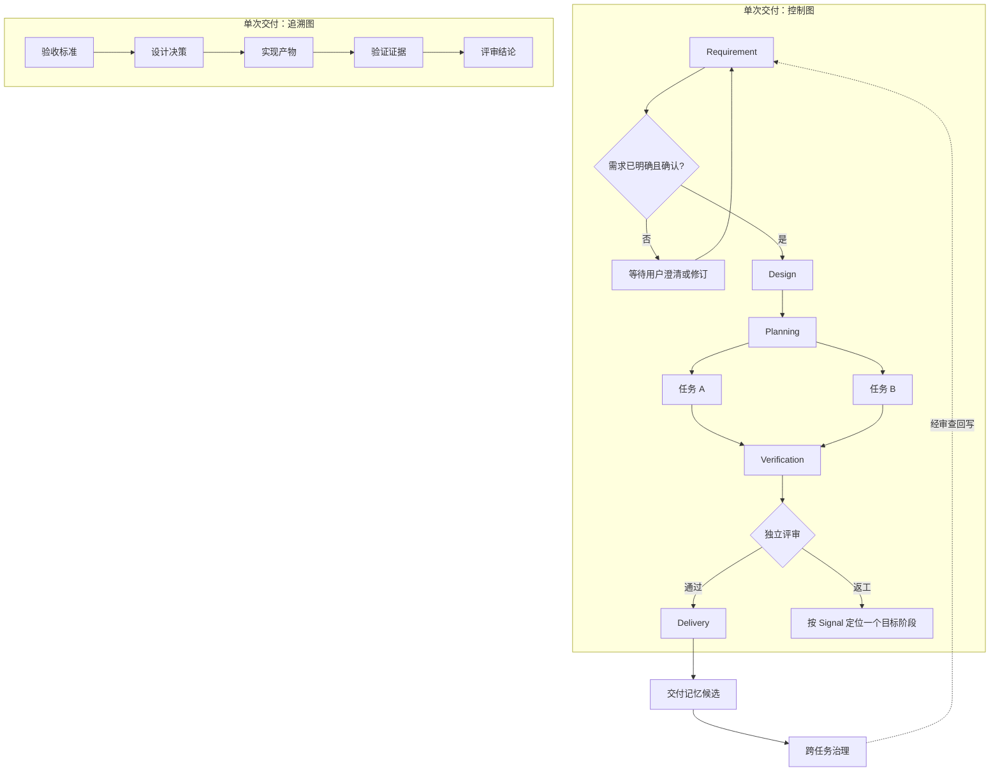

# Graph Engineering 方案草案 v1

> 状态：待用户审阅，未生效；不改变现行 Harness Engineering 规程。
>
> 日期：2026-09-26
>
> 维护责任：仓库 Harness Engineering 规程维护者。若 2026-10-26 前未完成审阅，应标记为 stale，重新核对仓库现状后再使用。
>
> 范围：AI 工程代理的外部交付方法。Agent Cluster 仅作为参考实例；本文不授权新增产品 API、数据库、页面或运行时模块。

## 1. 目标与边界

本方案在现有 Harness Engineering 上增加“关系可见、决策可追溯、返工可定位”的图式交付方法。它解决三个问题：

1. 阶段产物有了，但需求、设计、任务、验证和最终结论之间的覆盖关系不容易检查。
2. 阶段推进、人工确认和返工路由有规则，但具体一次任务为什么能走某条路径，常依赖聊天记录解释。
3. Delivery Memory 和治理回写有闭环描述，但跨任务的证据链没有统一表示方式。

Graph Engineering 不替换现有四控制面和编号规程。Harness 定义约束；Graph 把一次交付中的约束、产物和决策组织为可检查的关系。图可以先是文档中的结构化记录，不要求图数据库、图引擎或可视化页面。

权威边界仍以 [00 Boundary and Principles](./00-boundary-and-principles.md) 为准。本草案中的 Agent Cluster 映射只用于说明可行性，不能反向定义通用 Graph Engineering。

### 本次草案不做的事

- 不修改 `AGENTS.md`、`.claude/CLAUDE.md` 或现有 Harness 规程。
- 不把现有产品 Workflow 的 `nodes/edges` 宣称为通用 Graph Engineering 标准。
- 不要求所有任务都画图；单步、低风险任务继续使用现有简短交接。
- 不引入 LangGraph、图数据库或另一套业务工作流引擎。

## 2. 现有 Harness 的继承关系

| 现有权威规程 | Graph Engineering 中的作用 | 保留的不变量 |
| --- | --- | --- |
| [01 Intent Contract](./context-engineering/01-intent-contract.md) | 图的目标、范围、验收节点来源 | 待确认问题未解决，不进入下游决策 |
| [02 Context Protocol](./context-engineering/02-context-protocol.md) | 给节点输入标注来源、状态和适用阶段 | stale/conflict/inference 不充当已验证事实 |
| [03 Agent Role Protocol](./architecture-constraints/03-agent-role-protocol.md) | 节点责任人与授权边界 | Coordinator 不替代独立 Review |
| [04 Stage Workflow](./architecture-constraints/04-stage-workflow.md) | 必经阶段与阶段准入、退出门 | Requirement、Design、Review 等不得跳过 |
| [05 Tool Governance](./architecture-constraints/05-tool-governance.md) | 工具动作边的风险和确认要求 | 高风险动作先确认，越界动作不执行 |
| [06 Human Intervention](./feedback-loop/06-human-intervention.md) | 人工确认门和等待状态 | 未得到明确选择时不沿默认边继续 |
| [07 Feedback Loop](./feedback-loop/07-feedback-loop.md) | 失败信号与单一返工目标 | 跨阶段问题回到正确阶段，返工有上限 |
| [08 Delivery Memory](./entropy-management/08-delivery-memory.md) | 跨交付证据和经验候选 | 候选不自动成为长期记忆 |
| [10 Agent Working Protocol](./architecture-constraints/10-agent-working-protocol.md) | 每类节点的输入、输出和异常处理 | Agent 不越权修改上游结论 |
| [12 Continuous Governance](./entropy-management/12-continuous-governance.md) | 长闭环的漂移检测和规则回写 | 长期规程变更须有重复证据与变更记录 |

现有 [Harness 闭环模型](./harness-engineering-%E9%97%AD%E7%8E%AF%E6%A8%A1%E5%9E%8B.md) 的 8 条信号边继续有效。本方案只补充每条边在具体交付中的实例、条件和证据引用，不重编号、不复制其权威规则。

## 3. 两层图模型

一次交付使用两个相互引用、但语义不同的图：

1. **控制图 Control Graph**：阶段、任务、确认门和评审门如何推进。边说明准入条件与失败去向。
2. **追溯图 Trace Graph**：需求、设计决策、任务产物、验证证据和结论如何相互支持。边说明覆盖、依赖、证明或否定关系。

跨任务治理另维护一条 **Governance Trail**：失败模式候选 -> 正式记忆 -> 两次以上同类漂移证据 -> 规程回写 -> 下次交付验证。它不参与单次任务的实时调度。



图中 TaskA 与 TaskB 只在任务依赖和文件/工具边界允许时并行。Requirement、Design、Planning、Verification、Review、Delivery 仍按现有阶段规程交接；任务并行不等于跳过阶段。

## 4. 最小图合同

这是一份**交付记录合同**，不是当前产品的 TypeScript API 合同。

| 对象 | 最小字段 | 约束 |
| --- | --- | --- |
| `GraphRevision` | `deliveryId`, `revision`, `sourceRefs`, `createdAt` | 变更图时形成新 revision；旧决策可追溯 |
| `Node` | `id`, `kind`, `stage`, `ownerRole`, `inputRefs`, `outputRefs`, `state` | ID 稳定；状态只能由有权角色或明确用户决策改变 |
| `ControlEdge` | `from`, `to`, `condition`, `decisionBy`, `evidenceRefs` | 条件可判断；无证据时不得声称条件成立 |
| `TraceEdge` | `from`, `to`, `relation`, `evidenceRefs` | 关系限 `covers/depends_on/produces/proves/refutes/supersedes` |
| `GateDecision` | `gateId`, `question`, `options`, `actor`, `choice`, `sourceRef`, `graphRevision`, `decidedAt` | 没有明确选择则保持 waiting；记录所确认的 revision |
| `ReworkRecord` | `signal`, `sourceNodeId`, `targetStage`, `invalidatedRefs`, `newAttempt`, `evidenceRefs` | 一次返工只有一个目标阶段；不得覆盖旧 attempt |

建议节点类型仅保留 `stage`、`task`、`human_gate`、`review_gate`、`artifact`、`evidence`、`governance_decision`。控制图使用前四类；追溯图使用后两类和阶段产物；治理决定单独留在 Governance Trail。不要把 Agent 本身当成阶段节点：Agent 是责任主体，可在不同阶段承担不同任务。

追溯边统一按“主语 -> 宾语”记录：`Design -> Acceptance` 表示设计 `covers` 验收标准，`Task -> Design` 表示任务 `depends_on` 设计，`Task -> Artifact` 表示任务 `produces` 产物，`Evidence -> Acceptance` 表示证据 `proves` 验收标准。这样图的方向不会随展示布局改变。

### 节点状态与准入

控制节点状态：`blocked -> ready -> running -> completed`，另有 `waiting_user`、`failed`、`cancelled`、`invalidated`。`ready` 必须由以下条件共同决定：

- 所有必需上游节点已完成，输入产物可读取且未失效。
- 本节点的责任角色、允许范围、工具策略明确。
- 相关 `openQuestions` 已清空；所需人工确认与高影响方案确认已记录。
- 上游所用 Context 没有影响当前决策的 `stale` 或 `conflict` 项。

任一条件不满足时保持 `blocked` 或 `waiting_user`。模型对“已完成”“已确认”的自述不是状态转换证据。

### 分支、汇合与并行

- 分支条件必须有结构化、可审查的判断结果；不允许仅凭自然语言摘要静默选边。
- 初版汇合只用 `all`：每个必需上游成功，且所需证据齐全，下游才就绪。
- 未选择的分支标记 `skipped`，不能伪装成成功产物。
- 并行任务的 `allowedPaths`、工具副作用和共享资源必须先检查冲突；冲突时串行或进入人工决策。
- 图的单个 revision 应无拓扑环。返工通过新 attempt 和新的决策记录表达，不靠无限循环边实现。

## 5. 关键流程

### 5.1 初始需求和用户修订

主 Agent/Coordinator 首先把用户输入映射为 Intent Contract。存在待确认问题、方案存在高影响选择、或用户对修订尚未明确认可时，控制图停在 `human_gate`。确认必须指向当前 Brief/Graph revision；旧确认不能批准新版本。确认后才允许进入 Design、任务分发或执行。

这延续现有“待确认时不得继续”的要求，不允许把超时、用户沉默或模型推断当成同意。

### 5.2 正常交付

Requirement 产出 Intent；Design 为每项验收标准给出覆盖关系；Planning 形成任务依赖和授权边界；Implementation 产生产物；Verification 逐项附证据；Review 独立判断；Delivery 只引用通过评审的结果。每次推进同时新增控制边决策与追溯边，不在交付末尾补造证据链。

### 5.3 返工和失效传播

Review/Verification 发出 `07 Feedback Loop` 中的 Signal 后，记录单一目标阶段，标记相关下游产物与证据为 `invalidated`，创建目标阶段的新 attempt，并按 `02 Context Protocol` 重组上下文。新 attempt 通过后，受影响的下游节点重新验证；未受影响的节点保留原结果和证据。相同 Signal、相同目标阶段第二次返工即按现行 Harness 进入 Human Intervention，不擅自第三次循环。

### 5.4 长闭环

返工先形成 Delivery Memory 候选；Delivery 阶段筛选可复用项。Governance 依据至少两次交付的同类漂移证据，决定 `keep/adjust/split/merge/deprecate/escalate`，在 `governance/rule-change-log.md` 记录回写位置，并在下一次治理中复查。一次偶发失败只能产生候选，不能直接改长期规程。

## 6. 最小交付示例

以下展示人工维护的关系记录；字段可放入现有 Task Plan、Review Report 附录，不要求立即创建新工具。

```yaml
deliveryId: D-2026-001
revision: 2
control:
  nodes:
    - { id: R, kind: stage, stage: requirement, ownerRole: coordinator, inputRefs: [USER-1], outputRefs: [BRIEF-2], state: completed }
    - { id: G, kind: human_gate, stage: requirement, ownerRole: user, inputRefs: [BRIEF-2], outputRefs: [EVENT-7], state: completed }
    - { id: D, kind: stage, stage: design, ownerRole: architect, inputRefs: [BRIEF-2], outputRefs: [DESIGN-1], state: completed }
    - { id: T1, kind: task, stage: implementation, ownerRole: implementation, inputRefs: [DESIGN-1], outputRefs: [], state: ready }
  edges:
    - { from: R, to: G, condition: "需求契约已形成", decisionBy: coordinator, evidenceRefs: [BRIEF-2] }
    - { from: G, to: D, condition: "用户明确确认当前 revision", decisionBy: user, evidenceRefs: [EVENT-7] }
    - { from: D, to: T1, condition: "设计覆盖验收标准且任务已授权", decisionBy: coordinator, evidenceRefs: [DESIGN-1] }
trace:
  edges:
    - { from: DESIGN-1, to: AC-1, relation: covers, evidenceRefs: [BRIEF-2] }
    - { from: T1, to: DESIGN-1, relation: depends_on, evidenceRefs: [DESIGN-1] }
gateDecisions:
  - { gateId: G, actor: user, choice: approve, sourceRef: EVENT-7, graphRevision: 2 }
```

这个例子的 `T1` 仍须满足工具权限与输入证据条件才能从 `ready` 转为 `running`。YAML 是草案表达示例，现有系统不需要解析它。

## 7. 与 Agent Cluster 的参考映射

本节是 reference，不属于通用规程，也不构成当前产品改造授权。

| Graph 概念 | 当前参考对象 | 已知限制 |
| --- | --- | --- |
| Intent 与确认门 | Task Brief、`openQuestions`、确认事件 | 需保持未确认时停止执行的 fail-closed 行为 |
| 控制节点 | `WorkflowNode`、`WorkflowNodeRun` | 当前主推进状态仍依赖 `currentNodeId` |
| 控制边 | `WorkflowEdge` | 当前 `WorkflowsService` 会由节点顺序重建线性边 |
| 任务依赖 | `AgentTask.dependsOnTaskIds` | 与 Workflow 边并非同一权威来源，需要对账 |
| 图版本 | `WorkflowVersion.definitionHash`、Run 快照 | 新定义不能静默替换用户已确认版本 |
| 审计与恢复 | Event、Effect、Recovery、File/PostgreSQL | 并行推进还需要节点级幂等与跨实例并发控制 |

因此产品侧若未来要执行 DAG，应另立产品需求和设计：先规定分支、汇合、并行写入、失效传播、取消、重启恢复，再扩展合同与运行时。不能通过修改本草案让当前线性 Workflow 自动获得 DAG 能力。

## 8. 采用路径与审阅门槛

| 阶段 | 交付 | 完成条件 |
| --- | --- | --- |
| G0 草案评审 | 本文与边界选择 | 用户确认外部方法范围、术语和不变量 |
| G1 规程映射 | 对现有 01-08、10、12 标注图字段的来源与交接点 | 无重复权威规则、无相互冲突条件 |
| G2 模板试用 | 用现有 Intent、Task Plan、Review 模板记录一条真实交付图 | 可追溯需求 -> 设计 -> 任务 -> 证据 -> 结论 |
| G3 返工试用 | 用一次真实返工验证失效传播和上下文重组 | 单一目标阶段、旧 attempt 保留、下游重新验证 |
| G4 治理试用 | 从两次以上同类失败形成治理决策与回写记录 | 记忆候选、正式沉淀、回写、复查均有证据 |
| G5 正式采用 | 评审通过后再修订 Harness 入口、模板和工作协议 | 旧交付方式可迁移；新规则有维护者与复查周期 |

G0-G4 不要求修改产品。G5 是否让 Agent Cluster 执行 DAG，需要单独的产品授权与验收合同。

### 评审检查表

- [ ] 是否保持 Harness 外部规程与 Agent Cluster 产品实现的边界？
- [ ] 控制边的条件是否可以判断，并能指向明确证据？
- [ ] 每条验收标准是否能追到设计、任务、验证和评审结论？
- [ ] 未确认的需求或方案是否必然停止在确认门？
- [ ] 返工是否只指向一个阶段，且能定位失效下游？
- [ ] 并行任务是否有明确资源与权限边界？
- [ ] 长期规则回写是否符合“两次同类漂移证据”门槛？
- [ ] 小任务是否可以继续走简化的现有 Harness 流程？

## 9. 待用户审阅的决策

1. **定位**：建议 Graph Engineering 作为 Harness 的扩展方法，而非替代现有四控制面。
2. **首期载体**：建议先使用文档和现有阶段模板，不新增产品图运行时。
3. **采用范围**：建议先选一项真实复杂交付和一项返工案例试用；小任务不强制建图。
4. **后续产品化**：只有用户另行确认后，才设计 Agent Cluster 的 DAG 执行版本。

在上述决策得到审阅前，本文保持草案状态，不接入任何 Agent 入口文件。
