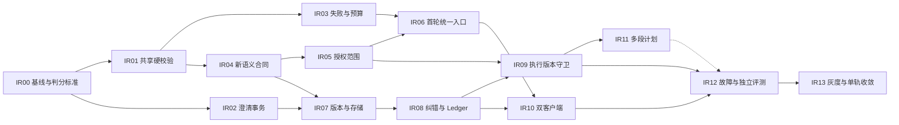

# 意图识别与纠错开发任务 v1

> 日期：2026-10-19
> 状态：待实施；以下任务均未因本文创建而完成。
> 上游：[系统开发设计](../design/intent-recognition-correction-system-development-design-v1.md)
> 验收：[验收矩阵](../quality/intent-recognition-correction-acceptance-v1.md)
> 问题依据：[2026-10-19 评测](../quality/intent-evaluation-2026-10-19/README.md)

## 1. 开发目标、范围与约束

目标是把“识别、授权、应用、纠错、重试”连成可验证闭环。沿用现有 Context v2、命令守卫、WorkItem、Ledger、Tool Authority、LogicalOperation、关系存储和 Outbox；按最小任务修改已有模块。

本轮用户要求系统开发设计，不是授权发布或修改生产配置。实施本清单时须基于当时工作区重验代码，不覆盖已经存在的 Orchestrator、Sessions、Runtime 控制和 Web/Desktop 未提交修改。业务实现与本轮文档交付分别记录状态。

## 2. 任务依赖



图表示代码依赖，不要求启动多 Agent，也不等于必须并发开发。第一阶段 IR01–03 可独立提供安全修复；新合同默认不开 enforce。IR11 到 IR12 的虚线仅在启用 ordered_plan 时为必需依赖，默认多意图澄清版本可先完成其它验收。

## 3. 任务拆分与完成条件

### IR00：冻结基线与标注口径

- 保存工作区 SHA、dirty diff 指纹、配置模式、依赖版本和已有相关测试结果。
- 保留原评测题和原分数，不通过修改旧 oracle 抹掉历史问题；建立新合同版本的回归题和旧题映射。
- 固定多意图、否定作用域、已完成“继续”、安全拒绝、缺旧决定澄清等判定口径。
- **完成条件**：现有测试文件清单可复现；L17/L20/L20B 分类解释明确；新断言同时覆盖标签和业务效果。

### IR01：统一服务端硬校验（第一阶段）

- 从 SemanticIntentRouter 提取 `IntentPolicyService`/纯校验函数；引入关系/动作/上下文允许组合。
- 内部 deterministicDecision 复用 CommandStateResolver，不再保留独立 COMPLETED/resume 判定。
- 风险由动作/目标/用户证据计算；原生明确 pause/cancel 继续快速执行；模型低风险标签不能绕过。
- RouteApplication 和 ContextManagement 提交时再次校验必要事实；结构化 clarify 不能手填全部 validation=true。
- 旧实际链路增加相同的派发前保护，不能只在 shadow 链路修复。
- **完成条件**：V15/V16/V17 的新回归通过，C01–C16 和现有 Runtime 控制回归不退化，拒绝行为在真实入口可见。

### IR02：澄清选择与确认绑定（第一阶段）

- 改造 Sessions clarify 的已 ROUTED 提前返回逻辑。
- 保存 confirmationId、规范化 choice/payload、actor、幂等键和 resolution revision。
- 在同一事务判断重复/冲突/失效，原子提交确认解决事件和业务结果。
- 增加 expectedRoutingRevision，提供有限的旧客户端适配；不存在/跨会话/过期 ID 不接受。
- **完成条件**：相同选择顺序/并发重放均只产生一次效果；相反选择至少一方明确 409，不能两个成功声称采纳不同选择；H05 的强化合同通过。

### IR03：失败分流、修复反馈和总预算（第一阶段）

- 将系统不可用与语义歧义区分；认证/配置错误不走业务规则兜底。
- Schema 修复携带具体字段错误和前次受限输出，最多一次；引用/权限冲突不能当格式错误猜答案。
- 分类循环、队列恢复、快照重建使用同一 LogicalOperation；重启不刷新 attempts/deadline。
- 记录 adapter 内部重试/用量未知；不能据 providerRequests=0 得出没有模型调用。
- **完成条件**：一次瞬时故障可恢复，401 一次停止，格式修复有反馈；所有组合最多 2 次平台 invocation，未知旧执行不重放。

### IR04：新语义输出合同（第二阶段）

- 新增 `intent_understanding` 输出 kind（1.0），定义分段、效果、禁止项、目标、证据和缺失项。
- 更新 registry、instructions、examples、mock 和 Generic/Codex/Claude 对合同的传递；保留 Context v2。
- 服务端验证引用原文区间、候选 ID、明确 @、依赖图与大小上限。
- 新增 `RoutePlanCompilerService`，生成有限动作；旧 handlingPlan 不再从 free text 产生额外派发。
- **完成条件**：严格 Schema 和 registry 测试通过；L11 第二目标可审计；新增合同不会碰撞现有 task_execution_result 2.0 选择逻辑。

### IR05：效果与执行权限分离（第二阶段）

- 新增 `ExecutionScopeResolverService`；有效授权与阶段/工具/工作区/Runtime 能力求交，并应用 scoped prohibitions。
- 迁移 InvocationResolver、专业任务/Workflow 派发和子任务中依赖 requiresCodeChanges 推导权限的调用点。
- 隔离源码写入、测试临时写入、报告产物写入、任意命令和外部写入；不能约束的 Runtime 明确 blocked。
- 在 Tool Authority 与写回门校验同一 scope；子任务不得扩大权限。
- 修改当前 `cli-tool-authority.ts` 中测试依赖 writeMode 的逻辑，同步 Codex/Claude/Bridge 的实际能力限制；不能只改上层标记。
- **完成条件**：T 组只读反例无实际源码变更；保存报告成功；测试不会写回源码；“不改表结构”不会误禁所有代码变更但阻止 schema 改动。

### IR06：首轮、普通消息与暂停识别统一（第二阶段）

- 首轮持久化 routing，延后 ensureInitialWorkItem/Brief；支持问答无 WorkItem。
- 扩展 ingress/route 返回值和恢复逻辑，移除“所有结果都必须有 WorkItem”的隐含前提。
- 新增 routing/business 准入区分；暂停/完成状态下只允许无工具识别，业务 admission 保持关闭。
- 快照增加纠错候选、授权引用、执行摘要和明确遗漏；新增消息级 BLOCKED 并同步队列/轮询终止条件。
- 检查 source preparation、Autopilot、恢复 worker 等自动启动入口，统一消费已提交计划。
- 多意图本阶段默认澄清；按已有约束保留精确命令快路径。
- **完成条件**：创建会话到专业 Runtime 首次调用之间存在已提交合法计划；模型故障不会提前开始 Brief；暂停纠错可被保存且不误恢复执行。

### IR07：版本化路由持久化（第三阶段）

- 建立 route revision、resolution、correction、step 实体；扩展 WorkItem requirementRevision/executionEpoch/hold。
- 补齐 File collections、关系表/映射/索引、collection scope、删除与 dataEpoch 边界。
- 提供 additive 迁移、dry-run、旧 choice receipt 映射和 unknown 授权处理；历史数据不猜权限。
- **完成条件**：File/PostgreSQL 读写、迁移、事务失败与重启等价；新消费者可读旧数据，旧 worker 不能接管新合同。

### IR08：纠错 API 与决定作废（第三阶段）

- 新增 corrections API；普通聊天纠正统一调用该服务。
- 接收纠错与明确目标 hold/epoch 原子提交；模型调用在事务外。
- 将 Decision supersede 抽成 draft mutation；要求旧版本匹配，处理子任务继承的局部覆盖。
- 明确接受/停止中/待核对/生效状态；失败保留 hold，并提供受控恢复。
- **完成条件**：实际 10→30 分钟约束替换后，Context/Brief/后续执行不再使用 10；并发纠错一方冲突；无旧目标时合理澄清。

### IR09：执行与回调版本绑定（第三阶段）

- AgentTask/InvocationPlan/receipt 绑定 intentRevision、requirementRevision、executionEpoch、sessionGeneration 和 effectScopeHash。
- reserve、Adapter 启动前、业务发布前检查 binding；连接现有 stop 生命周期。
- 旧回调进入审计，禁止更新当前投影、继续下一步、自动写回。
- 已完成外部效果走对账/补偿，不能自动删除或伪造回滚。
- **完成条件**：排队/执行中/完成后/停止未知四类纠错验证通过；崩溃恢复不丢 hold，迟到结果不覆盖新状态。

### IR10：Web/Desktop 状态与纠错交互（第二、三阶段配套）

- Shared/API/Store 接入 current/effective revision；确认操作提交绑定与稳定幂等键。
- 处理 409/410、系统 blocked、多意图、纠错接收和生效状态；双客户端一致。
- 保留普通聊天入口，增加“理解有误/纠正”关联原消息；诊断标识默认收起。
- **完成条件**：无静默失败；重复点击、刷新、离线恢复、SSE 乱序不会倒退或重复派发；用户能区分“收到”和“生效”。

### IR11：有序多段计划（第三阶段后，可独立延后启用）

- 按 route_committed/execution_completed 依赖逐段调度，无环验证。
- 同版本 step 幂等；跨纠错版本关联已完成 effect，不重复执行前段。
- 默认任一不确定业务段暂停计划；可独立确定的明确暂停命令保留优先处理。
- **完成条件**：L11 的两目标可分别追踪；前段完成、后段失败重试只执行后段；修订计划不重复已完成效果。
- 未完成本任务时必须保持 `INTENT_MULTI_SEGMENT_MODE=clarify`，不能宣称已支持自动多任务路由。

### IR12：故障、独立评测与可观测性（第四阶段）

- 执行验收矩阵；复用已有 339 项回归，新增有效效果断言。
- 补真实确认卡、首轮、检查点、长历史、多轮纠错、File/PostgreSQL、双客户端和崩溃 E2E。
- 建立至少 500 条独立标注封存集，3 次运行；按类型报告指标与置信区间，保留原输出和仲裁。
- 生成模型/profile/policy/code/fixture 指纹；统计实际用量，未知不可计零。
- **完成条件**：安全项全过，语义门满足或明确保持受限模式；缺数据库/真实 Runtime 的部分必须标未验证，不能通过 mock 替代。

### IR13：灰度与旧链路收敛（第四阶段）

- shadow 仅观测；先修复主路径，再使用固定 cohort 灰度新 Session，随后验证既有 Session。
- 新记录和 hold 的读取/恢复能力先部署，启用新合同在后；固定回滚目标。
- 证明所有消费者不再依赖旧自由文本分类后移除 Coordinator 重复分类和危险 fallback。
- 同步 API/runtime/event/UI-state 合同、设计状态及功能清单；灰度操作需具体环境授权。
- **完成条件**：发布证据齐全、无双重执行入口、可回滚到兼容安全版本；不能只因代码删除就判完成。

## 4. 代码落点

下表路径相对仓库根目录；“新增”仅为拟定文件，不表示已存在。

| 区域 | 主要文件 | 任务 |
| --- | --- | --- |
| 共享合同 | `packages/shared/src/contracts.ts`、`runtime-contracts/{contract-types,output-contracts,registry,structured-output-instructions,index}.ts` | IR02/04/07/09 |
| 识别 | `apps/server/src/modules/intent-recognition/{intent-recognition,semantic-intent-router}.service.ts`、相关 spec | IR01/03/04/06 |
| 路由 | `modules/message-routing/{message-ingress,command-state-resolver,command-application,route-application}.service.ts` | IR01/02/06/08 |
| 新策略/编译/纠错 | `modules/message-routing/{intent-policy,route-plan-compiler,intent-correction}.service.ts`（新增）及 module 注册 | IR01/04/08/11 |
| Session | `modules/sessions/{sessions.service,sessions.controller}.ts` | IR02/06/08 |
| 上下文 | `modules/context-management/context-management.service.ts`、Context/缓存相关服务 | IR02/07/08/09 |
| 授权 | `modules/runtime-routing/invocation-resolver.service.ts`、`execution-scope-resolver.service.ts`（新增）、`modules/tools/tool-authority-resolver.service.ts` | IR05/09 |
| 执行恢复 | `modules/runtime-invocation/`、`modules/runtimes/{logical-operation-store,cli-tool-authority}.ts`、现有 execution/recovery/Workflow 调用点 | IR03/05/06/09 |
| 持久化 | `modules/persistence/{persistence.service,collection-scope}.ts`、`relational/{relational-schema,relational-state-store}.ts` 和迁移工具 | IR02/07/08 |
| 专业编排 | `modules/orchestrator/orchestrator.service.ts` 及任务/Workflow 派发调用点 | IR05/06/09/13 |
| 客户端 | `apps/web/src/{stores/session.ts,api/client.ts,components/ConfirmationCard.vue,components/SessionWorkspace.vue}`、`apps/desktop/renderer/components/SessionWorkspace.vue` | IR10 |
| 测试 | 相关单元 spec、`tests/evaluation/`、`tests/e2e/` | 全部 |

所有 `modules/` 简写均位于 `apps/server/src/modules/`；开发开始前用符号引用检索全调用链，不根据此表遗漏动态 Workflow、恢复和子任务授权入口。

## 5. 验证与交付顺序

每个任务先跑对应单元/集成；Shared 改动后先 build shared。完整阶段合并前按仓库要求运行：

```powershell
npm run typecheck
npm run test
npm run test:harness
npm run build
npm run test:e2e:phase-2a-routing
npm run test:e2e:phase-6-fault-matrix
npm run test:e2e:phase-6-crash-restart
npm run test:e2e:phase-6-postgres
npm run test:e2e:phase-6-backend-parity
```

PostgreSQL 使用独立测试数据库；真实 Runtime 使用隔离项目，不能向生产库/工作区制造失败。新验收脚本在实施任务中补充，脚本名不冒充已可运行命令。原真实模型套件仅在合同/模型/策略变化或未解决问题需要复核时重跑，不能替代新合同评测。

每阶段交付：修改范围、测试证据、失败/未验证项、迁移/兼容状态、下一阶段入口。IR01–03 是第一批开发入口；IR13 的发布、放量和生产迁移需在已有可审查产物基础上再按项目规则执行。

## 6. 本轮文档交付记录

本轮只完成设计与任务拆解，核对本地代码和已完成评测证据，验证文档链接与 diff 格式。未运行新的产品测试、真实模型调用或数据库迁移；各任务保持待实施。
