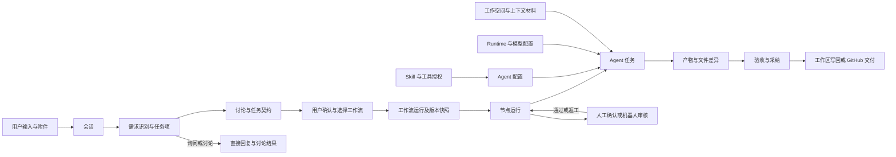
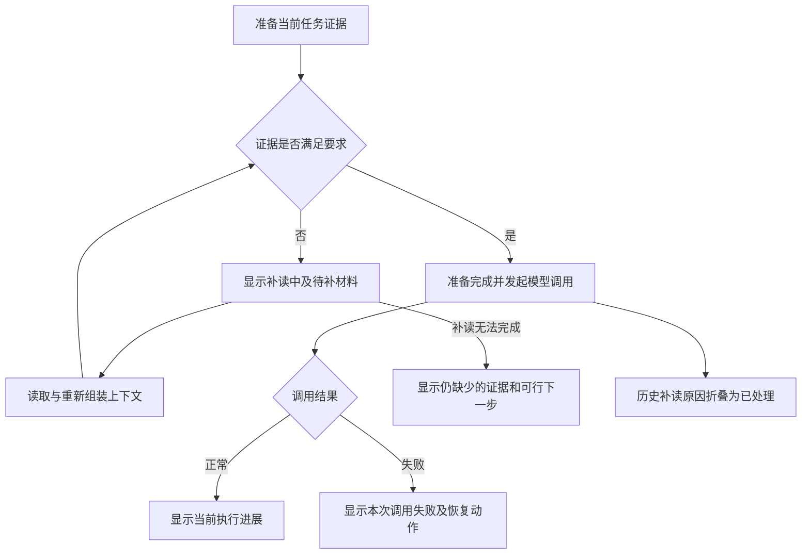

# Agent Cluster 现状功能与页面优化 PRD

> 版本：v1.0 · 基线日期：2026-10-17 · 状态：页面设计输入稿  
> 适用对象：产品、交互、视觉设计、前后端研发与测试。  
> 基线：当前本地工作区代码（包含尚未提交的改动）、现有路由、运行中的 Web 页面及相关合同。本文不是已发布版本的验收报告。

## 1. 文档目的与阅读方式

本 PRD 将系统现在能做什么、用户从哪里操作、功能之间如何连接，以及后续页面应该如何优化放在同一份文档中。设计师可以据此画信息架构、用户流程、页面原型和状态稿；研发可以区分纯展示优化与需要补充服务能力的需求。

本文保留当前产品边界，不覆盖原始 [v1 PRD](agent-cluster-prd-v1.md)。历史 PRD 描述的目标与当前代码存在差异时，以本文标明的代码基线为准；涉及未来行为的条目必须经过实现与验收，不能因为写入本 PRD 就视为已有能力。

### 1.1 范围

- Web 的 10 类主导航页面、工作台内部视图、主要弹窗与抽屉。
- Desktop 的独立任务工作区、工作流使用方式、本机连接与后台助手。
- 会话、需求任务、Agent、Skill、工具、模型、Runtime、工作空间、文件产物和交付之间的关系。
- 当前功能的完整度、可见操作、关键约束、正常与异常状态。
- 后续页面优化的目标结构、优先级、交互要求和验收场景。

本次只编写产品文档，不修改业务代码，不创建真实执行任务，不发布工作流，不改模型凭据，不执行 GitHub 发布或合并。

### 1.2 证据和状态标记

| 标记 | 含义 | 使用边界 |
| --- | --- | --- |
| 现有 | 当前源码中有明确页面、操作与调用路径 | 不等于本次对所有分支做了端到端验收 |
| 受限 | 有实现，但受配置、设备、授权、状态或局部实现限制 | 设计必须显示限制条件，不能画成随时可用 |
| 后端 | 已找到服务/API，但当前主导航没有完整操作闭环 | 新增页面时需补交互、接口适配和验收 |
| 建议 | 本 PRD 提出的优化需求 | 尚未实现，不计入当前能力 |
| 待核验 | 当前证据不足以作出可靠承诺 | 不用历史文档、按钮外观或接口名称替代验证 |

本次核验包括路由、组件、关键服务与合同阅读，以及运行中 Web 工作台和 Agent 管理页面的只读检查。Desktop 以当前源码为依据，未进行完整原生客户端操作验收。外部模型成功率、GitHub 真实交付、所有 Runtime 组合和生产环境稳定性不在本次验证范围。

### 1.3 推荐阅读顺序

- 产品负责人：第 2、3、4、11、12、14 章。
- 交互与视觉设计师：第 3～10、12、13 章。
- 研发与测试：第 5～8、10～15 章。

## 2. 产品定位、用户与目标

### 2.1 产品定位

Agent Cluster 是以会话为入口的多 Agent 协作工作平台。用户提出需求，系统组织讨论、确认任务范围、选择或运行工作流、分配 Agent 执行，并将过程、文件变化、审查结果和交付状态呈现给用户。平台同时提供 Agent、Skill、工作流、Runtime 和模型等配置能力。

核心价值包括：让一个需求可以被多个专业 Agent 协同处理；让用户在需要时控制执行；让结果可以追溯到需求、执行过程与文件变化。

### 2.2 用户角色

以下是设计角色，不代表当前已经存在对应的账号、角色权限或多租户系统。

| 角色 | 核心任务 | 常用页面 | 主要关注 |
| --- | --- | --- | --- |
| 需求发起者 / 开发者 | 提出任务、补充材料、确认范围、查看和接收产物 | 工作台、本地运行 | 当前在做什么；是否需要我处理；结果在哪里 |
| 任务审核者 | 审查方案、节点产物、文件差异，要求返工或批准 | 工作台确认卡、流程详情、交付面板 | 审核对象和版本明确；意见能回到正确任务 |
| Agent / 流程维护者 | 维护角色能力、Skill 引用、工具边界与流程模板 | Agent、Skill、工作流管理 | 配置有效；引用完整；发布不影响历史运行 |
| 平台 / 环境维护者 | 连接 Runtime、处理版本与设备问题、配置模型 | 本地运行、模型、设置、桌面连接 | 哪层不可用；配置在哪里生效；怎样恢复 |

### 2.3 页面优化目标

1. 用户进入工作台后能识别当前会话、当前需求任务、当前状态和下一步动作。
2. “讨论”“执行”“等待用户处理”“已停止”“运行异常”在文案和操作上明确分开。
3. 历史问题解决后不再占据当前故障位置，同时仍可追溯原因。
4. 配置资源与执行过程有清晰入口关系；跨页操作后能回到原任务。
5. Web 与 Desktop 使用同一业务语言，同时保留各自工作区结构和能力边界。
6. 产物、差异、验收和交付形成闭环，避免只有聊天记录而找不到最终结果。

### 2.4 本轮页面优化的非目标

不默认新增多人组织权限、计费订阅、插件市场、任意 DAG 流程引擎、生产级无人值守自动运行、完整向量数据库或移动端应用。Harness Engineering 属于工程交付规程，不作为新的产品页面或运行时功能。

## 3. 产品对象与功能关系

### 3.1 对象词典

| 对象 | 面向用户的含义 | 主要关系与设计要求 |
| --- | --- | --- |
| 会话 Session | 一组持续的对话、工作空间和执行记录 | 可包含多次需求处理；会话列表不等同于 Agent 任务列表 |
| 需求任务 WorkItem | 会话中一次独立需求的处理单元 | 新需求与原任务返工应区分；激活历史项不意味着重新执行 |
| 任务契约 Brief | 对目标、范围、约束、验收和参与者的结构化约定 | 用户确认后驱动后续执行；修改应显示版本或变更 |
| 工作流定义 Workflow | 可复用的步骤配置 | 有草稿、发布版本与归档；编辑定义不等于改变正在运行的实例 |
| 工作流运行 WorkflowRun | 某次按选定版本执行的记录 | 关联定义快照、节点运行、任务和产物；历史选择必须显式 |
| 节点 / 节点运行 | 流程步骤及其一次执行记录 | 节点可为 Agent、人工确认或机器人审核；重试和返工不能混成同一次 |
| Agent 任务 Task | 某个 Agent 承担的一项工作 | 需要目标、状态、结果、失败原因；不同于全局 Agent 配置 |
| Agent | 带身份、职责、Profile 和能力边界的角色 | 被会话/流程选用，引用 Skill 与工具；系统 Agent 与用户 Agent 有差异 |
| Skill | 可复用工作规则和附属文本文件 | 可被 Profile 引用，也可在输入框显式选择；不是已执行任务 |
| 工具 / Capability | Agent 能够请求的操作能力 | 是否注册、是否授予、当前是否批准、执行是否成功是不同状态 |
| Runtime | 实际承载模型或代码执行的运行环境 | 当前 UI 包含通用大模型、Codex、Claude Code；设备在线不等于调用成功 |
| 模型配置 Model | 模型标识、服务地址、凭据位置和可选价格 | 会话偏好、系统 Agent 策略与可用 Runtime 共同约束实际调用 |
| 工作空间 Workspace | 任务可读取或修改的代码来源和目录边界 | 本地目录或 GitHub 来源等；绑定、授权、内容读取、写回分别呈现 |
| 附件 / 知识库 / 记忆 | 用户材料、可检索资料与经确认的上下文信息 | 来源、作用域不同；不能把一次上传等同于永久知识写入 |
| 产物 / 文件修订 / 交付 | 任务输出、待采纳的候选修改和最终交付动作 | 生成、验证、采纳、写回、PR 发布、合并是不同完成层级 |
| 事件 / 通知 | 过程记录及需要用户关注的事项 | 事件可历史保留；当前待处理数量应以有效事项计算 |

### 3.2 执行与资源关系图

下图是产品对象关系图，不表示每个任务都必须经过全部步骤，也不表示数据库外键或严格一对一关系。



### 3.3 跨功能依赖

| 上游功能 | 下游功能 | 关系 | 页面应如何表达 |
| --- | --- | --- | --- |
| 本地设备连接与目录授权 | 新建会话、文件读取、代码执行 | 环境前置条件 | 缺少条件时给“去连接 / 去授权”，保留创建草稿 |
| 模型配置与 Runtime 可用性 | 讨论、任务执行、系统 Agent 调用 | 执行依赖 | 显示实际采用环境；配置存在不应显示为调用已验证 |
| Agent Profile + Skill + 工具 | 会话成员、流程节点执行 | 能力依赖 | 被引用资源失效时说明受影响角色和节点 |
| 工作流发布版本 | 选流与运行 | 使用依赖 | 可用目录只提供符合条件的已发布版本；历史运行显示快照 |
| 任务契约确认 | 进入相应执行路径 | 用户决策 | 显示确认对象、变更内容、确认后的动作 |
| 附件处理 / 上下文补读 | Agent 可用证据 | 数据准备依赖 | 区分已上传、已解析、已读取、已纳入当前调用 |
| 节点输出 | 下游节点、审核、交付 | 数据与顺序依赖 | 可定位上游来源；重跑时说明可能受影响的下游 |
| 文件基线 + 候选版本 | 修订采纳、写回冲突处理 | 版本依赖 | 比较对象明确，不能把历史差异当作当前目录状态 |
| GitHub 来源授权与准备 | PR 发布、差异审查、合并 | 条件功能链 | 不适用的会话不显示可执行交付按钮 |
| 当前有效确认项 | 工作台提醒、通知展示 | 状态投影 | 已处理后同步退场；历史事件继续可查 |

### 3.4 概念分界

- 会话是协作容器；需求任务是工作单元；Agent 任务是执行分工。三者不要都用一个无上下文的“任务”标题表示。
- Agent 能力配置中的连线外观，不证明 Skill 和 Tool 按该顺序自动执行。流程步骤的控制关系由工作流定义承担。
- 模型、Runtime、设备、后端和 SSE 是不同对象。一个绿色连接标记不能代表所有对象健康。
- “生成完成”“验证通过”“写回完成”“PR 已发布”“已合并”不能共用一个模糊的“已完成”。

## 4. 当前信息架构与页面结构

### 4.1 Web 路由与主导航

Web 当前有 10 类主导航入口。`/` 与未知路由回到工作台；工作台的无会话路径和指定会话路径属于同一类页面。

| 页面编号 | 导航名称 / 路由 | 当前主要内容 | 完整度与边界 |
| --- | --- | --- | --- |
| P01 | 工作台 `/workspace`、`/workspace/:sessionId` | 会话列表、聊天、计划、流程、协同看板、审计、成员与任务状态 | 主执行工作区；内部视图丰富，状态较复杂 |
| P02 | 本地运行 `/local-runtime` | 设备、连接、Runtime、授权目录、安装和启动指引 | 受本地助手、版本与设备状态限制 |
| P03 | 工作流管理 `/workflows` | 列表、草稿编辑、节点配置、校验、发布和归档 | Web 提供编辑；运行中的实例在工作台查看 |
| P04 | Agent 管理 `/agents` | 列表、Profile、能力引用、配置、测试/日志/版本标签 | 标签名称表达的范围大于部分实际能力，见第 11 章 |
| P05 | Skill 管理 `/skills` | 规则与附属文件、引用、修订、增删改 | 可操作；删除受引用约束 |
| P06 | 知识库 `/knowledge` | 知识库概览卡片 | 当前主要为只读展示 |
| P07 | 设置 `/settings` | 默认参数展示、SSE、后端地址、版本信息 | 当前主要为状态展示，不是完整偏好设置中心 |
| P08 | 模型管理 `/models` | 模型列表、本地/远程模型配置、默认项、价格信息 | 可操作；真实可用性依赖环境和凭据 |
| P09 | 工具集成 `/tools` | 后端能力注册表、名称、描述、风险级别、标识 | 当前主要为只读能力目录 |
| P10 | 通知中心 `/notifications` | 当前会话或回退会话中的高优先级、确认、错误事件 | 不是跨会话通知收件箱 |
| P11 | 连接本机 Runtime `/local-runtime/activate` | 设备连接 / 授权承接页 | 辅助流程页，不是独立主导航 |

### 4.2 Web 工作台的区域和视图

```text
全局导航
└─ 工作台
   ├─ 会话区域：创建、搜索、收藏、归档与历史切换
   ├─ 当前会话信息：标题、状态、预算/用量与控制
   ├─ 主视图
   │  ├─ 协作计划：任务目标、分工、进度和依赖
   │  ├─ 对话：消息、附件、确认卡、输入框、条件性文件/交付面板
   │  ├─ 工作流：执行链路与 Agent / 阶段详情
   │  ├─ 协同看板：协作事件的关系呈现
   │  └─ 审计：调用、工具决策、上下文证据和 Token 数据
   ├─ Agent / 任务状态区域
   └─ 叠加交互：新建、契约编辑、选流、加入成员、修订、差异、删除等
```

上述是功能区域，不限定每种视图都保持同样的列宽或侧栏。不要把“工作流管理”的定义编辑器与工作台中的运行流程图设计成同一个状态不明的画布。

### 4.3 Desktop 与 Web 的差异

| 维度 | Web 当前实现 | Desktop 当前实现 / 限制 |
| --- | --- | --- |
| 入口与布局 | 全局导航 + Web 工作台 | 独立 renderer、路由与任务工作区布局，不是直接嵌入 Web 工作台 |
| 任务视图 | 计划、对话、工作流、协同看板、审计 | 默认视图标签为“群聊消息 / 流程图 / 工作流详情”，有工作流后显示 |
| 辅助视图 | 主导航及工作台模式切换 | 源码仍可识别部分看板/审计模式，但不应据此画成默认顶部标签 |
| 右侧区域 | Agent 和任务状态等 | 群聊时为 Agent 状态；非群聊时为只读群聊或选中节点详情 |
| 工作流管理 | 可创建和编辑定义 | `/workflows` 路由跳回工作台；通过工作流目录选择已发布流程 |
| 工作流历史 | Web 对应运行展示能力 | 运行选择器、定义快照、节点详情、只读历史差异 |
| 环境连接 | 本地运行页面、授权承接页 | 另有 `/desktop` 平台连接页、后台助手和客户端更新功能 |
| 关闭行为 | 浏览器页面生命周期 | 关闭窗口不等于停止后台助手或会话；退出和安装更新需处理进行中的任务 |

设计时优先统一对象名称、状态和关键动作，不要求两端所有页面完全同构。原生通知、更新、设备助手等属于 Desktop 专属场景。

### 4.4 关键二级交互清单

| 编号 | 交互面 | 内容和返回位置 |
| --- | --- | --- |
| X01 | 新建会话与创建确认 | 需求、Agent、代码来源、目录、Runtime / 模型；成功进入新会话 |
| X02 | 任务契约编辑 / 确认 | 目标与正文、参与者、修改说明；回到当前需求任务 |
| X03 | 工作流选择 / 成员映射 | 已发布版本、节点角色、可用成员；回到待执行状态 |
| X04 | 人工确认 / 机器人审核结果 | 审核内容、通过、修改或取消；定位到所属节点 |
| X05 | Agent 加入确认 | 新成员身份及将可见的当前历史和附件上下文 |
| X06 | 文件修订与候选编辑 | 基线、候选、草稿、迭代与采纳决定 |
| X07 | 差异预览 / 历史差异 | 来源运行、文件路径、版本；关闭后保持原节点选择 |
| X08 | 工作区写回 / GitHub 冲突 | 冲突文件、解决方案与提交状态；回到交付或会话 |
| X09 | Runtime 请求详情 / 停止状态 | 当前请求、最近活动、故障与停止确认 |
| X10 | Agent Profile / 模型 / Skill 编辑 | 配置草稿、校验、保存；返回原资源并保持选择 |
| X11 | 归档 / 删除确认 | 作用对象、处理进行中调用、恢复与清理范围 |
| X12 | Runtime 版本升级 / 桌面更新 | 当前和目标版本、阻塞任务、更新进度 |

## 5. 功能清单：会话、讨论与执行

功能编号供设计稿、研发任务和验收用例引用。最后一列是后续页面要求，不表示已经全部实现。

### 5.1 会话与需求管理

| 编号 | 功能与当前行为 | 状态 | 页面优化要求 |
| --- | --- | --- | --- |
| F01 | 创建会话：填写需求、选择 Agent、代码来源、工作空间及 Runtime / 模型偏好，并确认创建 | 现有 / 受限 | 先突出需求与代码位置；高级参数折叠；缺失前置条件可就地修复 |
| F02 | 会话列表、搜索、切换、收藏 | 现有 | 以标题、最近活动、状态、待处理数识别会话；切换时保持正确草稿归属 |
| F03 | 会话归档与恢复 | 现有 | 区分归档与停止；仍在停止中时不提前提示归档成功 |
| F04 | 会话删除与生命周期处理 | 受限 | UI 的“不可恢复”与服务端恢复路径存在差异；先统一合同，再定确认文案 |
| F05 | 会话中的独立需求项与历史选择 | 现有 / 受限 | 新需求和原需求返工区别展示；切换历史只改变查看对象，不自动执行 |
| F06 | 用户输入的意图识别与必要澄清 | 现有 | 正在识别时显示处理状态；询问进度不应被页面解释为重新执行任务 |
| F07 | 会话实时事件、历史加载和路由恢复 | 现有 | 加载失败、后端离线、SSE 断开分别反馈；保留输入并提供重试 |
| F08 | 用户消息删除接口及界面关联能力 | 受限 | 使用删除标记/生命周期语义，不承诺删除所有已形成的执行上下文；入口需与现有可操作范围核对 |

### 5.2 输入、材料、讨论与契约

| 编号 | 功能与当前行为 | 状态 | 页面优化要求 |
| --- | --- | --- | --- |
| F09 | 群聊文本输入、发送中状态、发送失败反馈 | 现有 | 输入、发送、停止和继续的状态互不混淆；保留失败内容 |
| F10 | 附件上传、处理状态、重试及图片识别相关流程 | 现有 / 受限 | 文件卡显示名称、处理阶段和可用性；失败附件可单独处理 |
| F11 | `/Skill` 选择及附加工作规则 | 现有 | 已选 Skill 可见、可移除；明确作用于本次消息或相关任务的范围 |
| F12 | `@Agent`、成员选择与新增成员确认 | 现有 / 受限 | 展示成员身份；加入前说明历史和附件可见范围 |
| F13 | 多 Agent 讨论与讨论结果呈现 | 现有 | 作者、角色、所属需求、阶段清晰；避免自动进度消息淹没讨论结论 |
| F14 | 讨论文档创建、选择、读取等服务能力 | 后端 / 局部承接 | 不直接宣称已有完整文档中心；后续若新增中心需补列表和版本交互 |
| F15 | 任务契约生成、查看、编辑、确认与拒绝 | 现有 | 确认前显示本次版本及变化；拒绝/修改要明确返回哪个阶段 |
| F16 | 参与 Agent 调整、成员映射、替换与跳过等决策 | 现有 / 受限 | 只显示当前状态允许的动作；提示影响节点和后续执行 |
| F17 | 上下文不足触发补读、准备进度、补读结果和历史原因 | 现有 | 读过路径不等于证据满足；补读成功后历史原因折叠，当前标题显示已完成准备 |
| F18 | 记忆候选及确认相关服务/会话决策 | 受限 | 区分临时输入与已确认记忆；不假定存在独立记忆管理页面 |

### 5.3 工作流使用、执行与人工控制

| 编号 | 功能与当前行为 | 状态 | 页面优化要求 |
| --- | --- | --- | --- |
| F19 | 等待选流时选择已发布工作流版本 | 现有 | 名称、版本、简介、节点和角色需求可比较；不自动替用户选流 |
| F20 | 工作流按版本快照运行，读取历史运行和节点记录 | 现有 | 当前与历史运行明显区分；显示定义版本、开始时间与结果 |
| F21 | Agent 节点执行，查看任务进度、依赖与产物 | 现有 | 节点卡显示责任 Agent、当前状态、输出摘要；详情提供过程和结果 |
| F22 | 人工确认节点：通过、要求修改、取消 | 现有 | 同一确认只有一个生效结果；要求修改时填写意见 |
| F23 | 机器人审核节点：结构化通过、返工、拒绝 | 现有 / 受限 | 审核失败、格式异常、返工超限需可识别地进入人工处理；不可仅显示红点 |
| F24 | 节点返工、上游重跑、Agent 替换与相关补救 | 现有 / 受限 | 显示返工原因、次数和影响范围；保留既有结果作为历史 |
| F25 | 会话停止、停止确认、继续执行及取消相关流程 | 现有 | 停止中与已停止分开；未确认的调用仍可追踪；不承诺自动回滚文件 |
| F26 | 单次调用健康信息与“继续等待” | 现有 | 等待不隐式重发请求或重置预算；展示调用对象和最近有效活动 |
| F27 | Runtime 切换建议/决策与回退配置 | 现有 / 受限 | 显示实际切换结果和原因；配置回退序列不等于每次都会切换 |
| F28 | Token 用量、预算及模型定价信息 | 现有 / 受限 | 区分已知、估算和未知；价格缺失不能显示费用为零 |
| F29 | 协作计划、流程图、协同看板等执行视图 | 现有 | 各有问题定位目标：计划看分工，流程看步骤，看板看协作关系 |
| F30 | 调用审计：Agent 身份、工具授权、执行目标、上下文证据、Token | 现有 | 放入诊断层；为普通用户提供中文摘要及可复制诊断标识 |

### 5.4 产物、文件修订与交付

| 编号 | 功能与当前行为 | 状态 | 页面优化要求 |
| --- | --- | --- | --- |
| F31 | 产物消息、文件变更展示、历史差异查看 | 现有 / 两端有差异 | 结果集中可查；明确来源需求、运行、文件和比较版本 |
| F32 | 选择文件基线、参与 Agent 与修订要求 | 现有 | 显示捕获的基线；开始前让用户知道本次编辑对象 |
| F33 | 候选版本、人工草稿保存、再次处理、采纳或放弃 | 现有 | 草稿与候选不混同；离开未保存内容时提供保护；采纳后显示落地状态 |
| F34 | 文件修订的部分失败、恢复与重试决策 | 现有 / 受限 | 显示成功部分和失败 Agent；不让用户误以为全部内容丢失 |
| F35 | 工作区写回失败/冲突：重试、交给 Agent、保留目录、采用会话版本、放弃 | 现有 / 受限 | 冲突文件可定位；覆盖类决定显示具体影响范围 |
| F36 | GitHub 来源准备：认证、仓库/分支选择、准备状态和重试 | 现有 / 受限 | 跟随服务端能力开关和授权；失败停在可恢复步骤 |
| F37 | GitHub 交付：查看状态/差异、验证、发布或重试发布、刷新 | 现有 / 受限 | 将验证结果与发布结果分开；展示目标仓库、分支与 PR |
| F38 | 审查当前提交、冲突编辑、squash 合并和实际合并差异 | 现有 / 受限 | 确认绑定当前提交；提交变化后旧确认不能继续充当新确认 |
| F39 | 最终交付摘要、质量/复盘相关执行结果 | 现有 / 受限 | 摘要包括完成项、验证、剩余问题、产物入口和可选交付状态 |

## 6. 功能清单：配置资源与平台辅助

### 6.1 工作流管理

| 编号 | 功能与当前行为 | 状态 | 页面优化要求 |
| --- | --- | --- | --- |
| F40 | 工作流列表：名称搜索、草稿/发布/归档状态、Agent 与节点概览 | 现有 | 显示明确版本与最后更新时间；不把静态分页外观视为完整分页能力 |
| F41 | 新建与编辑草稿、保存、校验、撤销/重做 | 现有 | 脏状态、保存反馈、退出保护；校验结果定位到字段或节点 |
| F42 | 节点增加、删除、排序和配置 | 现有 | 编辑器按当前支持的结构设计；不默认支持任意分支、循环与并行 DAG |
| F43 | Agent 节点：角色、阶段说明、输入与输出约定 | 现有 | 引用失效时阻止发布并给修复入口 |
| F44 | 人工确认节点：标题、指引、决策项 | 现有 | 展示面向最终审核者的预览；修改意见必填条件明确 |
| F45 | 机器人审核节点：审核 Agent、提示、准则、最大返工次数 | 现有 | 显示异常和超限后的人工处理规则 |
| F46 | 发布版本、归档、删除草稿 | 现有 / 受限 | 已发布版本不可被静默改写；受维护令牌要求时说明保存/发布前置条件 |

### 6.2 Agent 管理

| 编号 | 功能与当前行为 | 状态 | 页面优化要求 |
| --- | --- | --- | --- |
| F47 | Agent 列表、名称搜索、系统/用户标识、启用数 | 现有 | 当前选择清楚；状态名称统一；系统角色不能伪装成完全可编辑 |
| F48 | 创建/编辑名称、标签、Profile Markdown | 现有 / 受限 | 系统字段限制明确；保存失败保留草稿 |
| F49 | Profile 编译预览、估算 Token 与诊断 | 现有 | 诊断关联编辑位置；“校验通过”不表示真实任务执行成功 |
| F50 | Skill / Tool 资源搜索、引用添加/拖入/移除、保存编排 | 现有 | 表达为能力组合与授权；引用状态和资源来源可见 |
| F51 | 系统 Agent 的首选 Runtime、模型与允许 Runtime 策略 | 现有 / 受限 | 显示该策略适用对象；不要暗示所有普通 Agent 拥有同样配置界面 |
| F52 | 用户 Agent 的启用与停用 | 现有 | 展示停用对后续选择和现有引用的影响，不假定删除历史任务 |
| F53 | “测试”标签执行 Profile 重新校验 | 受限 | 当前应命名为“配置校验”；真实试运行需另定义输入、费用与结果 |
| F54 | “日志”标签展示创建/更新两类概要信息 | 受限 | 不称为完整执行日志或修改审计；若补历史需真实数据源 |
| F55 | “版本”标签展示当前 Profile 修订 | 受限 | 不提供虚假的历史比较/回滚承诺；完整版本管理列为后续需求 |

### 6.3 Skill 管理

| 编号 | 功能与当前行为 | 状态 | 页面优化要求 |
| --- | --- | --- | --- |
| F56 | Skill 列表、范围、状态、修订与更新时间 | 现有 | 支持从 Agent 引用返回对应 Skill；不同范围可识别 |
| F57 | 新建/编辑名称、描述和规则正文 | 现有 | 名称唯一校验可理解；字数限制在接近阈值时提示 |
| F58 | 管理附属文本文件与相对路径 | 现有 / 受限 | 展示文件计数、体积/字符预算及非法路径原因；不可伪装为任意文件托管 |
| F59 | 删除 Skill 及引用占用保护 | 现有 | 被引用时指出引用关系，指导先解除引用 |
| F60 | 可用 Skill、分类和引用相关服务 | 后端 / 部分 UI 使用 | 输入选择器可用不等于已拥有完整分类后台或市场 |

当前 Skill 编辑器约束：名称最长 100 字符，描述最长 500 字符，规则最长 100000 字符；附属文件最多 20 个、每个最多 100000 字符、合计最多 500000 字符，并验证安全相对路径。设计稿应使用字符限制，不把这些数值标成字节容量。

### 6.4 模型与 Runtime

| 编号 | 功能与当前行为 | 状态 | 页面优化要求 |
| --- | --- | --- | --- |
| F61 | 模型配置列表、创建、修改、删除和默认模型 | 现有 | 区分模型标识与显示名；默认标记与当前调用模型分开 |
| F62 | 本地与远程模型、协议、服务地址、服务器/本地设备凭据位置 | 现有 / 受限 | 根据类型渐进显示字段；地址示例说明是否包含 API 前缀 |
| F63 | 凭据编辑遮蔽与保留原值 | 现有 | 不回显密钥；编辑留空保留的语义明确，清除另设明确动作 |
| F64 | 输入/输出价格及价格版本 | 现有 / 受限 | 单位 USD / 百万 Token；成对填写；缺失状态标“未配置” |
| F65 | 本地设备列表、在线状态、Runtime 能力与兼容性 | 现有 | 设备、助手、Runtime 和模型分别显示状态 |
| F66 | 安装/启动指引、复制命令、唤起助手、连接设备 | 现有 / 受限 | 按未安装、未启动、未连接、版本不兼容给对应步骤 |
| F67 | 工作目录授权、目录选择与授权目录列表 | 现有 / 受限 | 展示路径、设备和授权边界；授权完成后可回到原创建流程 |
| F68 | Runtime 版本与升级提示 | 现有 / 受限 | 展示要求版本、当前版本和受影响动作；不靠重试掩盖不兼容 |
| F69 | Desktop 平台地址、连接保存与工作台入口 | 现有 / 受限 | 远程 HTTPS 与本机回环 HTTP 规则清楚；错误在字段附近反馈 |
| F70 | Desktop 助手启停、设备授权、工作空间入口 | 现有 / 受限 | 说明助手与窗口的不同生命周期；运行中退出有明确后果 |
| F71 | Desktop 完成通知设置与测试 | 现有 / 受限 | 区分系统通知权限和应用开关；测试操作需明确用户触发 |
| F72 | Desktop 检查、下载与安装更新 | 现有 / 受限 | 任务安全停止后才进入相应更新步骤；生产签名及分发状态待核验 |

模型配置变更主要面向后续调用，不应在页面中暗示它会直接改变已经开始的调用。具体适配器、模型与设备组合是否可用，应由服务端能力与执行反馈决定。

### 6.5 知识、工具、通知、设置和未形成页面闭环的能力

| 编号 | 功能与当前行为 | 状态 | 页面优化要求 |
| --- | --- | --- | --- |
| F73 | 知识库卡片：名称、范围、描述、检索配置名称、更新时间 | 现有 / 只读 | 名称与真实检索方式一致，避免“Embedding 模型”误导 |
| F74 | 创建知识库、添加文档、检索服务 | 后端 | 后续若产品化需完整导入、处理、检索与引用闭环；当前不能画成已有上传入口 |
| F75 | 工具目录：名称、描述、风险级别和能力标识 | 现有 / 只读 | 定位为“工具能力目录”；配置入口与 Agent 授权相连 |
| F76 | 工具能力注册、引用、检查和批准相关接口 | 后端 / 会话局部使用 | 能力注册与用户批准分开；不宣称所有工具都有连接器配置页 |
| F77 | 通知筛选当前/回退会话高优先级、确认和错误事件 | 现有 / 受限 | 显式显示会话范围；当前不是跨会话待办中心 |
| F78 | 设置页展示默认参数、连接、版本和运行模式 | 现有 / 只读 | 固定数值不标为真实可编辑设置；状态显示数据来源 |
| F79 | 定时 Autopilot 定义、运行记录与调度相关服务 | 后端 / 受限 | 当前实现强制 mock、低风险并受调度开关控制，不作为生产自动编码能力宣传 |
| F80 | 外部交付通知相关会话决策与集成 | 受限 / 待核验 | 未核验通道完整性，不作为当前全局通知设置；后续设计需明确目的地和确认范围 |

知识服务当前默认 `local-keyword-search`，可见实现为文本切块与关键词评分；存在名为 `embeddingModel` 的字段，不足以证明已经实现向量嵌入检索。

## 7. 逐页产品与设计要求

本章在第 4～6 章的现状上提出设计要求。除明确写为“当前”的内容，其余为建议目标；每页应与功能编号和第 12 章优先级一起使用。

### 7.1 P01 工作台

**用户目标：** 在一个会话内提出需求、监督协作、处理决策、查验结果，并安全地停止或继续工作。对应 F01～F39。

| 区域 | 信息优先级与内容 | 主要交互 |
| --- | --- | --- |
| 会话列表 | 标题、最近更新时间、运行状态、有效待处理数；收藏和归档分区 | 创建、搜索、切换、收藏、归档；删除放入更多菜单 |
| 当前任务头部 | 会话标题 + 当前需求任务；状态、代码来源摘要 | 切换需求历史；展开环境与预算；当前会话控制 |
| 当前状态与待处理区 | 当前阶段、有效阻塞、需要用户处理的事项 | 每个阻塞给一个明确主操作；多个事项可展开列表 |
| 主内容区 | 对话 / 执行 / 结果，复用现有子视图的数据 | 切换保留选择与滚动；详情返回不丢失上下文 |
| 对话时间线 | 用户需求、Agent 回复、契约、审核、产物；进度信息弱化 | 回复、查看详情、定位产物、处理当前有效确认 |
| 输入区 | 消息、附件、Skill、Agent，发送与执行控制 | 发送和停止可辨；异步意图识别不覆盖用户继续输入的草稿 |
| 右侧详情 | 当前选中的 Agent 任务、节点、调用或只读消息 | 跟随选择；关闭后主内容自动恢复宽度 |

主操作优先级为：需要用户处理的决定 → 当前执行控制 → 消息发送 → 查看历史和诊断。运行中不能把“发送消息”与“强制重启执行”设计成同一含义。既有“协作计划 / 对话 / 工作流 / 协同看板 / 审计”可在首轮保留；是否聚合成“对话 / 执行 / 结果”属于第 12 章的结构调整，不应先改名称后丢失原有信息。

**关键状态稿：** 无会话；新建草稿；切换加载；讨论中；待确认契约；待选流；执行中；补读中；等用户处理；停止中；停止状态未知；已停止；调用失败；已完成；历史只读。不同状态应复用同一布局骨架，避免警告出现时挤走输入区。

**结果呈现：** 当前产物卡、验证摘要、剩余问题、文件变更、写回状态和条件性 GitHub 交付放在可返回的结果区域。独立“结果”标签属于建议补齐，不应把当前零散消息呈现描述成已有统一产物中心。

### 7.2 P02 / P11 本地运行与设备连接

**用户目标：** 判断本机是否可执行任务，并完成连接与目录授权。对应 F65～F68。

页面按“设备 → 助手连接 → Runtime → 授权目录”组织，首屏显示当前设备摘要和唯一的下一步动作。详细命令、协议版本和诊断信息置于展开区。

| 场景 | 主要信息 | 建议主动作 |
| --- | --- | --- |
| 没有设备记录 | 安装/连接说明及适用系统 | 查看安装或连接指引 |
| 设备已登记但离线 | 最后在线时间、设备名 | 启动/唤起助手 |
| 助手连接但 Runtime 不可用 | 缺少的 Runtime 或版本要求 | 查看修复步骤 |
| Runtime 可用但未授权目录 | 可用环境、目录授权用途 | 选择并授权目录 |
| 满足条件 | 设备、Runtime、已授权路径 | 返回创建任务或新建会话 |
| 连接/升级失败 | 具体失败阶段与诊断入口 | 重试当前步骤 |

P11 作为连接承接页，只完成本次连接流程并返回来源；从工作台进入时建议携带返回目标和创建草稿标识。不得将完整本地路径、凭据或设备诊断默认传播到外部服务。

### 7.3 P03 工作流管理

**用户目标：** 创建可复用的执行步骤，并发布稳定版本供会话使用。对应 F40～F46。

| 子页面 / 区域 | 必要信息 | 主次动作 |
| --- | --- | --- |
| 列表 | 名称、简介、状态、版本、节点数、角色、更新时间 | 主：新建；次：编辑、查看版本、归档、删除草稿 |
| 编辑器顶部 | 名称、草稿/发布状态、保存状态、校验错误数 | 保存草稿、校验、发布；不可保存时明确原因 |
| 左侧节点资源 | 支持的节点类型、可用 Agent | 添加节点、搜索资源 |
| 中部结构 | 顺序、节点类型、关联角色和校验提示 | 选择、排序、移除、撤销/重做 |
| 右侧配置 | 所选节点字段、必填约束、输出约定 | 字段编辑、定位问题 |
| 发布确认 | 发布版本、节点概要、阻塞检查结果 | 发布或返回修正 |

字段约束沿用当前节点编辑器：节点名称最长 50 字符；Agent 阶段说明 300 字符；人工确认标题 80、说明 500 字符；机器人审核提示 1000 字符、最大返工次数 0～10。输入/输出契约、审核准则以可读列表呈现。

发布后在会话中的使用入口属于工作台；“使用流程”不应绕过任务状态、契约及成员映射要求。Desktop 提供目录选择，编辑入口应明确转至 Web，不能出现点击后静默回工作台的“管理”假入口。

### 7.4 P04 Agent 管理

**用户目标：** 定义角色职责与可用能力，并确认配置有效。对应 F47～F55。

左侧保持 Agent 列表；主区优先展示“身份与职责 / 能力引用 / 配置校验”；详情区展示被选资源的说明、来源与授权信息。系统 Agent 使用明显标识和字段级限制。

| 当前标签 | 首轮建议表达 | 范围说明 |
| --- | --- | --- |
| 编辑 | 能力配置 | Profile、Skill / Tool 引用、资源详情和保存 |
| 配置 | 运行策略 / 状态 | 按 Agent 类型显示实际支持项 |
| 测试 | 配置校验 | 明确只做编译、引用和授权关系校验 |
| 日志 | 配置概况，或移入基本信息 | 当前两条概要不能用时间线外观暗示完整审计历史 |
| 版本 | 当前修订 | 完整历史与回滚未补齐前不提供对应操作 |

能力组合优先使用可编辑资源列表或关系展示；若保留画布，所有加号、缩放、适应和锁定按钮都要有真实操作，否则隐藏。保存应体现身份/Profile 和能力引用的实际保存边界，避免局部已保存被误认为全部保存。

### 7.5 P05 Skill 管理

**用户目标：** 维护可复用规则及其附属文件，了解哪些 Agent 在使用它。对应 F56～F60。

列表显示名称、描述摘要、范围、状态、修订和更新时间。详情分规则正文、附属文件、引用关系；正文支持编辑和只读预览，文件支持按路径选择。创建成功后保留选中项，便于回到 Agent 能力配置。

删除被引用项应提供引用原因与可定位的 Agent；引用关系详情若后端未提供足够数据，应先补接口，不通过猜测构造引用列表。分类编辑、导入/导出、版本回滚均作为后续扩展，不画成当前主动作。

### 7.6 P06 知识库

**当前用户目标：** 查看平台已有知识库。对应 F73、F74。

首轮建议名称为“知识库概览”，每张卡显示名称、用途、范围、真实检索方式和更新时间；空状态说明当前没有可展示资料，不能用不可点击的“上传文件”制造操作预期。

完整知识库管理作为后续独立功能：库列表 → 文档列表 → 导入与处理 → 文档详情 → 检索试验 → Agent 使用关系。需先明确支持的文件格式、容量、处理失败、删除影响、引用来源和检索质量验收；不能只补一个上传按钮就认定闭环完成。

### 7.7 P07 设置

**当前用户目标：** 查看运行状态与版本。对应 F78。

首轮建议分为“连接与版本”“当前会话信息”，把固定显示的 `30000` 标明来源或改为读取真实配置。只有后端支持保存且明确生效范围时，才提供“默认预算”等表单。

SSE 连接状态应说明它属于哪一会话或当前页面；无活动会话时的“未连接”不必等同于系统故障。后端地址、运行模式和版本可供诊断，日常用户不需先理解这些字段才能使用工作台。

### 7.8 P08 模型管理

**用户目标：** 维护可供 Runtime 调用的模型配置。对应 F61～F64。

列表显示显示名、模型标识、来源/协议、凭据位置、设备（适用时）、默认状态。创建/编辑按本地与远程类型组织字段，费用信息置于可选区域。

必须表达四个不同事实：配置已保存、环境可发现、凭据是否具备、真实调用是否成功。若尚无连通性测试接口，不放一个只验证字段的“连接成功”按钮。修改默认模型后说明对后续调用生效；已执行记录保留当时模型信息。

API Key 采用遮蔽与明确保留机制。价格为可选数据，输入和输出价格成对校验；缺少价格的 Token 用量仍可显示，但费用应为未知而不是零。

### 7.9 P09 工具集成

**当前用户目标：** 查看 Agent 可绑定的工具能力及风险。对应 F75、F76。

首轮建议命名为“工具能力”，提供真实能力目录、说明和风险级别；有条件时展示被哪些 Agent 引用。查看目录、授予 Agent 能力、批准某次敏感调用是不同动作，分别在资源页、Agent 页、会话决策卡承接。

连接器安装、账户授权、凭据编辑、连接测试、版本更新等完整“集成市场”能力尚不能从当前卡片推出。未来新增时应以一种真实连接器完成闭环，再扩展通用框架。

### 7.10 P10 通知中心

**当前用户目标：** 查看当前会话相关的重要事件。对应 F77、F80。

首轮必须显示所选会话名称与范围，使用用户可理解的标题，不直接展示内部事件类型作为主标题。每条显示时间、来源、事项状态和可用操作；已解决事件保留在历史分组。

“跨会话通知中心”属于建议新增能力，需要独立处理会话范围、已读/未读、有效待办去重、目标定位和恢复后同步。没有这些数据前，不显示虚假的全局未读数。“没有历史高优先级事件”与“当前没有待处理项”也应分开。

### 7.11 Desktop 专属连接页与任务工作区

Desktop `/desktop` 页面区分平台连接、助手状态、设备/目录、通知和更新。主操作随当前阻塞改变，避免把所有维护动作平铺成同级按钮。

任务工作区保持左侧任务历史、中部群聊/流程图/详情、右侧上下文的结构；右侧只读群聊提供“去群聊处理”定位，不能在多个区域出现可重复提交同一决策的独立表单。历史运行和历史 Diff 明确只读。

关闭窗口、停止任务、退出助手和安装更新是四个动作。文案必须准确说明后台是否继续；运行中的退出或更新按照真实停止确认状态处理，不用固定等待秒数替代确认。

## 8. 端到端用户流程

### 8.1 本地项目执行任务

1. 用户从工作台新建会话，填写需求，选择本地目录与参与 Agent。
2. 系统核对设备、Runtime 和目录授权；不满足时定位缺失条件，保留创建草稿。
3. 创建后进入讨论与材料准备。代码内容按需要读取，不把创建成功等同于所有文件已进入上下文。
4. 系统形成契约，用户修改或确认；进入需要选流的阶段时选择工作流及角色映射。
5. 工作流按绑定版本执行，用户可查看节点、Agent 任务与请求健康。
6. 需要审核时暂停在明确决策点；通过继续，要求修改回到原需求的相应处理链。
7. 展示产物、验证摘要与文件差异；需要写回时反馈成功或进入冲突处理。
8. 完成后保留可追溯结果；用户可继续提新需求、查看历史或归档。

### 8.2 只询问、讨论或分析

用户提出问题 → 意图识别 → 必要材料读取和讨论 → 回复/文档结果。未要求执行代码时，界面不应强迫用户选工作流或让“确认”暗中变成修改文件。若需要从讨论转为执行，应显示明确的执行入口与范围。

### 8.3 补充要求与返工

用户在当前需求中提出修改 → 系统识别修改对象，必要时澄清 → 更新契约或节点修订要求 → 重新处理受影响部分 → 形成新结果与验证记录。任务历史需要保留原需求关联，同时区分修订次数、节点尝试和本次新产物。

独立的新需求应创建新的需求项；“再检查一下刚才的结果”不应仅因产生新消息就被设计成全新任务。无法确定时展示对象选择，而非默默猜测。

### 8.4 上下文补读与调用失败



补读流程应有终止与失败反馈，图中的回路不表示无限自动重试。历史 `evidence-empty` 已解决后，如果当前发生 provider 错误，主提示应展示后者。路径已读列表与实际纳入调用的证据数量分别呈现，防止“已补充”与“证据不足”无解释地同时出现。

### 8.5 停止、离线与恢复

用户点击停止 → 显示停止请求已提交 → 汇总相关调用的停止状态 → 全部达到明确结果后显示已停止或仍有待确认项。连接断开只说明状态不可确认，不能直接宣称已停止。继续执行需明确作用于哪个会话与需求项。

当用户仅选择“继续等待”，页面保持当前调用并更新健康提示；不得悄悄发送第二次任务。停止不会自动撤销已经写入的文件；结果区域保留停止前产物与未完成说明。

### 8.6 GitHub 交付

创建时选择 GitHub 来源 → 检查授权与仓库/分支 → 源码准备完成 → 执行任务 → 查看差异与验证 → 发布/更新 PR → 审核当前提交 → 处理冲突（如有）→ 用户明确合并 → 展示实际合并结果。

此流程仅对支持该能力且已授权的会话展示。验证失败、发布失败和合并失败分别停在对应步骤；发布 PR 不等于合并成功。每次提交变更后，审核依据与差异版本同步更新。

### 8.7 资源维护后返回任务

工作台发现缺少可用 Agent / Skill / 模型 / Runtime → 跳转对应配置页并记录返回位置 → 完成配置 → 返回原会话/创建草稿 → 刷新可用资源 → 用户继续选择。跨页面跳转不自动发布流程、不自动开始执行，也不丢弃尚未发送的需求。

## 9. 状态、动作与数据展示合同

### 9.1 状态分层

下表是面向用户的展示分类，不要求后端使用完全相同的枚举名。

| 状态对象 | 应独立表达的状态 | 不能推导的结论 |
| --- | --- | --- |
| 页面 / 后端 | 加载、可达、离线、版本不兼容 | 页面能打开不等于 Runtime 可执行 |
| SSE | 连接中、已连接、重连、断开 | SSE 已连接不等于模型有进展 |
| 设备 / 助手 | 在线、离线、未授权、不兼容 | 助手在线不等于代码目录可读写 |
| 上下文准备 | 未准备、补读中、可用、失败、取消 | 文件路径已读不等于本次证据门槛已满足 |
| Runtime 调用 | 排队、启动、运行、等待、失败、结束、状态未知 | 心跳更新不等于模型已输出业务内容 |
| 节点 / 任务 | 未开始、执行中、待审核、返工、成功、失败、取消 | 一个节点完成不等于整个需求交付完成 |
| 会话控制 | 可执行、停止中、已停止、停止待确认、可继续 | 请求停止已受理不等于所有调用已停止 |
| 交付 | 产物生成、待验证、待采纳、写回中、冲突、已写回、PR 状态 | PR 发布不等于主分支已包含结果 |

### 9.2 当前状态与可用动作

| 场景 | 主文案方向 | 主动作 | 次动作 / 禁用规则 |
| --- | --- | --- | --- |
| 尚无会话 | 开始一个需求 | 新建会话 | 连接本地环境、查看历史 |
| 后端不可达 | 无法连接服务，尚未确认任务状态 | 重试连接 | 保留草稿；禁用依赖后端的提交 |
| 等待契约确认 | 请确认本次任务范围 | 确认 | 修改、拒绝；展示版本 |
| 等待工作流选择 | 请选择执行流程 | 选择工作流 | 查看版本与角色要求 |
| 正在补读 | 正在补充任务所需材料 | 查看准备进度 | 允许适用的停止操作；不提示重复手工重试 |
| 准备成功 | 材料已就绪，正在继续 | 查看当前进度 | 历史缺失原因折叠 |
| 调用长时间无业务输出 | 当前调用尚未产生新结果 | 查看请求详情 | 按实际能力继续等待或停止 |
| 有效人工确认待处理 | 需要你处理当前节点 | 去处理 | 所有副入口指向同一确认对象 |
| 停止请求进行中 | 正在确认停止结果 | 查看停止状态 | 防止重复请求；不提前显示“已停止” |
| 已停止 | 当前执行已停止 | 继续执行（若允许） | 查看已有产物、取消/归档 |
| 历史运行查看 | 正在查看历史执行记录 | 返回当前任务 | 历史数据只读，动作绑定明确目标 |
| 写回冲突 | 需要选择如何处理文件冲突 | 查看冲突 | 覆盖类操作展示文件清单与确认 |
| 执行完成但未交付 | 结果已生成，请检查 | 查看结果 | 验证、采纳或发布按阶段出现 |

### 9.3 通用空态、错误态与刷新

- 加载中的列表用骨架或明确加载提示；不得短暂闪现“没有数据”。
- 真空数据、筛选无结果、加载失败分别提供“创建/查看指引”“清除筛选”“重试”。
- 异步保存禁用重复提交；成功反馈对应真实对象；失败不清空草稿。
- 事件恢复、刷新和重新进入页面后，同一确认项只能处理一次；已处理按钮失效并说明结果。
- 乱序或重复事件不能让旧错误覆盖较新的有效状态；必要时重新读取权威状态。
- 长过程保留最近更新时间；未知状态明确标为未知，不用绿色成功填补数据缺失。
- 会话和历史运行切换时清理不属于新选择的节点/任务详情，防止混合展示。

### 9.4 关键字段和来源

| 信息 | 来源原则 | 展示规则 |
| --- | --- | --- |
| 会话 / 任务标题 | 用户输入或实际保存的标题 | 长标题省略但可查看全文；不以 ID 作为默认名称 |
| 当前状态与待处理数 | 当前有效任务、确认和停止结果 | 不直接用历史错误事件数量代表当前故障数 |
| 流程版本 | 运行绑定的定义快照 | 与正在编辑的最新草稿分开 |
| Agent 与模型 | 对应任务/调用的实际记录 | 不能仅用全局默认配置倒推历史执行 |
| Token / 费用 | 实际用量、估算标记和对应价格版本 | 单位明确；未知值用“— / 未提供”，不显示零 |
| 文件差异 | 指定运行、基线、候选或提交 | 标清比较双方；过期状态可识别 |
| 时间 | 统一格式与时区约定 | 事件列表精确到秒；相对时间可补充但不取代详情时间 |
| 诊断信息 | 对应调用/事件标识和脱敏错误 | 中文原因在前，内部错误码和原始摘要在详情 |

## 10. 交互、视觉与非功能要求

### 10.1 信息层级与通用组件

沿用项目现有 Element Plus 基础和主色 `#409EFF`，首先统一页面标题、列表/详情、表单、状态标记、确认卡与错误提示。不要让管理页与工作台分别发展出多套含义相同的按钮和状态颜色。

| 组件 | 需要统一的内容 | 设计交付要求 |
| --- | --- | --- |
| 页面标题区 | 标题、说明、对象统计、主操作 | 主操作不被多个同级新增按钮稀释 |
| 状态标记 | 未开始、进行中、待处理、成功、失败、未知 | 颜色 + 图标 + 文字，不单靠颜色 |
| 当前阻塞卡 | 原因、影响、主动作、详情入口 | 同屏优先显示真正阻塞，历史已处理项降级 |
| 确认卡 | 对象、版本、待确认内容、选择、处理结果 | 防重复、失效态、已处理态完整 |
| 资源选择器 | 名称、类型、范围、可用性和缺失原因 | 不可用资源可解释，不能只隐藏造成困惑 |
| 列表详情 | 搜索、筛选、选择、空态、返回 | 保存选择与滚动；真实分页与加载策略匹配 |
| 文件/产物卡 | 路径、来源、状态、差异、操作 | 长路径可读；当前和历史版本可区分 |
| 诊断抽屉 | 用户原因、请求状态、脱敏详情、复制信息 | 不默认展开完整内部上下文和敏感材料 |

### 10.2 布局和响应式

建议设计验收覆盖 1440×900 与 1280×800 桌面窗口，并提供较窄桌面窗口下的侧栏折叠方案。具体列宽由原型验证后确定，不以本 PRD 数字替代实际适配。

- 三栏区域分别管理滚动，输入框与主决策在可见范围内。
- 窄窗口优先收起辅助信息；通过抽屉查看节点/Agent 详情，不压缩正文到不可读。
- 长 Profile、长消息、长文件路径、20 个附件文件条目等场景必须有溢出设计。
- 弹窗内容超高时正文滚动、操作区保持可达；关闭后焦点回到触发元素。
- 移动端完整编辑器不作为首轮目标；不能因此让小窗口完全无法查看任务与停止执行。

### 10.3 可访问性与可理解性

所有图标按钮有可读名称；键盘可触达主操作、标签、列表和弹窗；焦点可见，状态改变使用适当的可访问提示。流程图需提供可读节点列表或详情替代路径。输入错误说明修正方式，不仅标红。

普通页面使用“工作空间、运行环境、待确认、补读完成”等业务语言；`ContextEnvelope`、工具决策、请求 ID 等放在审计/诊断中。保留真实技术名，但不要求用户理解内部架构层次才能完成任务。

### 10.4 性能与一致性要求

大量消息、事件、Agent 或文件时，采用与实际数据量匹配的分段加载或渲染策略；不能以截断历史来伪装性能优化。列表返回保留选择；切换会话避免显示上一个会话的详情。前后端枚举和未知新状态应有可读回退，不造成空白页。

本次未测量性能基线。建议首轮测量“进入会话到首屏可读”“点击提交到本地反馈”“事件到达至状态更新”三个时间，页面交互反馈可先以 300ms 内出现本地反馈为设计目标；网络和模型耗时单独统计，不能纳入无条件 SLA。

### 10.5 权限、外部动作与数据边界

目录授权、增加成员、工具批准、文件覆盖、PR 发布与合并都要让用户知道对象和作用范围。确认应对应具体动作，不用一个笼统“同意全部”覆盖后续变化。

设计不承诺超出实际能力的恢复：停止不回滚文件；归档不等于删除；会话删除的恢复范围需要统一后确认；凭据删除不等于撤销第三方账户权限。页面只展示必要的脱敏凭据状态，导出的诊断避免包含密钥和无关文件正文。

## 11. 当前差异、缺口与设计风险

以下区分代码可核对的事实与产品层面的判断。本章用于安排优化工作，不代表所有项都在本次完成修复。

| 编号 | 当前证据 / 差异 | 对用户和设计的影响 | 建议处理 |
| --- | --- | --- | --- |
| G01 | 历史 PRD 与功能清单早于当前桌面独立工作区和多需求实现 | 照旧文档画图会遗漏对象层级和端侧边界 | 以本文路由/对象表为现状入口，保留历史文档用途 |
| G02 | 工作台承载多种模式、确认、修订、健康和交付面板 | 信息竞争是设计风险，尚无本次可用性量化结果 | 建立当前状态、待处理、正文、详情的优先级 |
| G03 | 补读历史原因、当前准备状态、后续调用错误属于不同时间与对象 | 同屏错误会被理解为同一个故障持续存在 | 按状态来源与时间归属呈现；当前工作区已有补读显示修复，仍需覆盖其他链路 |
| G04 | Agent 的测试实际上是 Profile 校验 | 用户可能误以为真实模型已验证 | 改名并限定说明；真实试运行另立需求 |
| G05 | Agent 日志为创建/更新概要，版本只显示当前修订 | 容易误以为已有历史追踪与回滚 | 收敛界面承诺；需要完整管理再补数据 |
| G06 | Agent 画布部分加号、适应、缩放、锁定控件未绑定动作 | 视觉暗示与可用能力不一致 | 完成真实交互或隐藏；不以装饰按钮占位 |
| G07 | 知识库卡片使用 Embedding 字段，当前检索实现为关键词评分 | 容易对检索方式和效果产生错误预期 | 按真实实现标明检索方式 |
| G08 | 工具页只读展示能力注册表 | “集成”名称容易暗示授权、安装和连接管理 | 首轮改为能力目录；完整连接器管理另列范围 |
| G09 | 通知来自当前/回退单会话，直接展示事件类型和内容 | 用户可能漏看其他会话；历史事件被误认为当前待办 | 显示范围、中文语义和有效性；全局中心后续补齐 |
| G10 | 设置页默认预算固定显示 30000，缺少编辑闭环 | 用户可能把展示值当作真实生效配置 | 读取真实来源或明确只读示例，避免假设置 |
| G11 | 会话删除 UI 写“无法恢复”，服务有 deleted 生命周期及恢复路径 | 恢复和清理边界不清，影响危险操作文案 | 核对附件/缓存等清理范围，统一恢复合同后再改提示 |
| G12 | Desktop 不提供工作流定义编辑，相关路由重定向 | 同样导航可能让用户不知为何离开 | 提供明确的 Web 编辑承接和返回说明 |
| G13 | 当前自动调度服务强制 mock、低风险 | 容易把后台骨架当成生产无人值守功能 | 在文档和导航上明确实验/未开放边界 |
| G14 | 文件修订、历史 Diff、工作区写回和 GitHub Diff 是多个比较上下文 | 用户可能查看或采纳错误版本 | 所有差异标题显示对象、来源与比较双方 |
| G15 | 当前代码有较丰富外部执行/交付路径，但本次只读核验 | 代码存在不等于环境已配置或生产可用 | 设计按能力返回值和授权状态控制，不用静态启用按钮 |

## 12. 优化方案与范围优先级

### 12.1 建议的信息架构

这是目标分组建议，不是当前已落地菜单。首轮可仅加分组和准确命名，不必立即改路由。

```text
执行
├─ 工作台：会话、当前需求、对话、执行、结果
└─ 待处理：首轮保留会话范围；跨会话聚合需补后端

资源
├─ 工作流（Web 编辑；Desktop 选择和查看）
├─ Agent
├─ Skill
├─ 工具能力
└─ 知识库

运行环境
├─ 本地运行
├─ 模型
└─ 系统信息 / 设置（仅实际可编辑项称为设置）

Desktop 专属
└─ 平台连接、后台助手、通知、更新
```

方案保留现有功能可达性，降低 10 个平级入口的识别成本。是否采用侧栏分组、二级导航或资源中心首页，在设计评审时用任务完成效率选择；不默认增加总览大屏。

### 12.2 优先级与实施边界

| 需求编号 | 优先级 | 交付内容 | 依赖 / 研发边界 | 验收依据 |
| --- | --- | --- | --- | --- |
| R01 | P0 | 当前状态、补读、调用失败、停止状态和历史原因分层 | 状态合同与事件投影；部分链路已有修复 | A05、A06、A07、A08 |
| R02 | P0 | 工作台有效待处理入口、原确认定位与防重复 | 需要确认项 ID、状态和归属 | A04、A09、A10 |
| R03 | P0 | 收敛 Agent 测试/日志/版本、画布无效控件与工具/知识命名 | 主要是展示和交互；不能假造后台数据 | A15、A16、A19 |
| R04 | P0 | 明确通知会话范围、设置值来源、删除恢复边界 | 删除语义须核对服务端与清理范围 | A11、A20、A21 |
| R05 | P0 | 会话切换、编辑草稿、历史对象和来源的保护 | 会话路由、草稿和详情状态管理 | A02、A03、A13、A24 |
| R06 | P1 | 新建会话渐进表单、环境缺失引导和返回草稿 | 本地运行与创建页之间的状态承接 | A01、A22 |
| R07 | P1 | 工作台执行视图与结果区重整、统一文件差异标题 | 聚合既有产物/调用/交付数据；可能需补查询 | A12、A13、A14 |
| R08 | P1 | 工作流管理列表/编辑/发布体验及桌面承接 | 保持版本快照与节点类型约束 | A17、A18、A23 |
| R09 | P1 | Agent、Skill、模型统一列表详情、保存与错误反馈 | 资源引用与凭据合同 | A15、A16、A25 |
| R10 | P1 | 跨页资源修复返回、统一空态和诊断组件 | 返回目标、状态缓存及统一文案 | A22、A24、A26 |
| R11 | P2 | 真正的跨会话待办/通知中心 | 新聚合、已读与有效事项模型；不能仅改 UI | 独立补充验收 |
| R12 | P2 | 完整知识库文档导入、检索验证和使用关系 | 文档处理、来源引用与检索质量能力 | 独立补充验收 |
| R13 | P2 | Agent 真实试运行、完整配置历史与版本比较 | 执行隔离、费用、版本保存和日志数据 | 独立补充验收 |
| R14 | P2 | 完整工具连接器管理和真实自动化执行产品化 | 权限、凭据、调度和恢复能力另行设计 | 独立 PRD，不纳入首轮美化 |

P0 解决错误理解、无效操作和状态不一致；P1 完成主要路径的结构与效率优化；P2 扩展产品能力。优先级是建议排期，不是已经承诺的开发计划。

### 12.3 设计实施顺序

第一批画工作台的正常执行、等待确认、补读恢复、停止与错误状态，再画新建会话和环境修复；第二批画工作流管理、Agent / Skill / 模型；第三批处理只读辅助页与桌面差异。每批先确认信息和行为，再细化视觉，不以统一卡片样式替代功能澄清。

## 13. 设计交付清单与验收

### 13.1 设计师需交付的内容

| 交付件 | 最低覆盖范围 |
| --- | --- |
| 信息架构图 | 当前入口到建议分组的映射，Web/Desktop 差异，保留与合并关系 |
| 主流程原型 | 新建与环境修复、讨论/契约、选流/执行、审核返工、停止恢复、文件采纳、GitHub 条件交付 |
| 页面稿 | P01～P11 及 Desktop 专属连接页；只读页按真实能力绘制 |
| 工作台状态稿 | 第 7.1 与第 9 章各关键状态，至少覆盖当前/历史两种查看模式 |
| 弹窗 / 抽屉稿 | X01～X12；含提交中、失败、已处理和失效态 |
| 组件与文案规范 | 状态、确认卡、错误卡、资源选择、产物卡、诊断抽屉、表单和列表 |
| 响应式说明 | 常规桌面、较小桌面、侧栏折叠、长内容和超高弹窗 |
| 行为标注 | 每个按钮的触发条件、接口/数据来源、成功、失败、权限和返回位置 |
| 需求映射 | 页面/组件标注 F 编号；优化任务标注 R 编号；验收引用 A 编号 |

交付原型不能只包含有数据且成功的理想状态。任何新画出的操作，如果不在现有功能清单里，都需要标注为新增能力。

### 13.2 关键验收场景

以下是后续设计/实现的验收要求，本次文档交付不表示这些场景已经全部执行通过。

| 编号 | 场景 | 预期结果 |
| --- | --- | --- |
| A01 | 本地设备未连接时新建代码任务 | 指出缺少的环境条件；可进入修复；原需求草稿保留 |
| A02 | 在两个会话之间来回切换 | 标题、消息、任务、待处理数、输入草稿和详情均归属正确 |
| A03 | 同一会话提出独立新需求，再查看上一需求 | 当前与历史明确区分；不意外重跑；返工仍可追溯原需求 |
| A04 | 编辑契约后确认 | 确认对象和版本明确；执行依据为确认后的内容 |
| A05 | 首次证据不足，自动补读成功 | 当前显示准备完成/继续中；旧不足原因折叠为已处理 |
| A06 | 补读成功后模型提供方报错 | 主错误说明当前调用问题；不继续要求补读已满足的材料 |
| A07 | 用户停止，部分调用尚未确认退出 | 显示停止中/待确认；不给“全部已停止”假成功 |
| A08 | 调用中 SSE 或后端断连，随后恢复 | 区分连接异常和任务结果；恢复后读取真实状态；不重复执行 |
| A09 | 同一确认从消息和待处理入口打开 | 指向相同对象；提交一次后所有入口同步变为已处理 |
| A10 | 机器人审核异常或返工次数达到限制 | 可见失败原因及人工处理入口；不无限自动循环 |
| A11 | 归档、恢复、删除各执行一次测试流程 | 文案、实际数据保留和恢复能力一致；删除用专用测试数据验证 |
| A12 | 文件修订中保存草稿，部分 Agent 失败 | 草稿和成功结果不丢；可按支持范围重试或决定继续 |
| A13 | 查看历史节点文件 Diff，再回当前结果 | 比较对象和运行版本明确；历史查看不触发文件写入 |
| A14 | 工作区写回冲突或 GitHub 提交更新 | 冲突对象明确；覆盖需具体确认；旧提交审核不冒充新审核 |
| A15 | Profile 校验通过但真实模型不可用 | 仅显示配置校验通过，不宣传 Agent 真实执行可用 |
| A16 | 删除被 Agent 引用的 Skill | 阻止无效删除并解释引用来源；提供可执行修复路径 |
| A17 | 编辑工作流草稿时切换页面 | 有未保存保护；校验错误定位节点；不能误发无效版本 |
| A18 | 新发布工作流版本后查看旧运行 | 旧运行仍显示原版本快照和历史结果 |
| A19 | 打开知识库、工具能力与 Agent 历史标签 | 名称和可操作范围与数据一致；不存在可见但无行为的主控件 |
| A20 | 无活动会话打开通知页 | 明确所展示的会话/范围；空态不误称全局无待办 |
| A21 | 查看设置中的预算和连接状态 | 来源清楚；固定展示不冒充已生效配置；未订阅 SSE 不直接判故障 |
| A22 | 从新建任务跳到模型或设备页修复后返回 | 返回原草稿；新资源可刷新选择；不自动启动任务 |
| A23 | Desktop 选择工作流并请求编辑 | 使用已发布版本；编辑明确承接至 Web；历史运行只读 |
| A24 | 列表加载失败、筛选无结果、快速切换对象 | 三类状态区分；无旧对象闪现或错误操作目标 |
| A25 | 修改模型配置但密钥留空、价格未填 | 按合同保留原密钥；费用显示未知；已有调用记录不被改写 |
| A26 | 键盘完成确认、关闭抽屉，在小窗口查看长内容 | 焦点与滚动可控；输入/停止/确认操作可达 |
| A27 | 点击“继续等待”后检查调用记录 | 保持原调用，不产生隐式重复任务或重置预算 |
| A28 | Desktop 运行中关闭窗口、退出或安装更新 | 三种行为按实际生命周期明确区分；需要停止时等待可信结果 |

### 13.3 建议度量

| 指标 | 定义 | 用途与建议目标 |
| --- | --- | --- |
| 状态识别正确率 | 测试用户能否说清当前阶段、是否需要操作 | 首轮可用性测试建议目标 ≥90%；不是当前实测值 |
| 首次处理定位时间 | 从进入会话到找到正确待处理事项 | 建议中位数 ≤10 秒；按任务复杂度分组 |
| 关键路径完成率 | 新建、确认、停止、查看产物等任务无协助完成比例 | 建立基线后比较改版；首轮建议 ≥90% |
| 状态矛盾数 | 当前成功/失败、停止中/已停止等互斥状态同屏冲突 | 验收场景内为 0 |
| 无效可见控件数 | 可点击外观但无真实行为的控件 | 验收范围内为 0 |
| 草稿错误归属或丢失数 | 切页、重试、失败导致内容丢失或发错会话 | 验收场景内为 0 |
| 决策重复提交数 | 同一有效确认产生多个业务决定 | 验收场景内为 0 |

以上目标需要设计评审后确定样本与测量方法。当前没有用户研究数据，不能把这些数值写入改版成果报告。

## 14. 未决问题与建议默认取向

| 问题 | 为什么需要决定 | 建议默认取向 |
| --- | --- | --- |
| Web 与 Desktop 是否统一导航外观 | 影响页面复用与用户迁移 | 先统一业务词汇与状态，保留独立工作区结构 |
| 会话与需求任务在列表如何呈现 | 用户容易将容器、需求、Agent 分工混淆 | 会话列表 + 会话内需求历史；Agent 任务放执行详情 |
| 是否首轮新增“结果”独立视图 | 产物分散，但新增聚合需数据核对 | P1 先聚合既有产物与差异，不扩展新的文档平台 |
| 删除的恢复期限、附件和缓存范围 | 决定危险操作确认与恢复入口 | 先梳理现有服务实际清理行为，再确定产品合同 |
| 通知是否必须跨会话 | 当前数据只是单会话事件筛选 | P0 说明范围，P2 再建设聚合待办 |
| Agent 是否必须有真实测试和版本回滚 | 涉及执行成本、隔离与新数据模型 | 首轮准确命名现有能力，完整功能独立排期 |
| 知识库是否升级为向量检索和文档中心 | 当前实现不支持直接作此承诺 | 保留关键词检索基线，以真实使用需求决定扩展 |
| 外部通知、自动化是否进入首轮设计 | 功能开关、授权与运行边界尚需专项核验 | 首轮不扩张，只表达已有可验证路径 |

这些问题不阻止按本文进行现有页面的第一轮设计；涉及新增服务能力或改变数据语义时，应先补充专项需求和接口合同。

## 15. 证据索引与后续维护

### 15.1 主要证据入口

以下链接相对本文所在目录，可直接在仓库内定位。功能描述以当前代码为事实依据，旧文档用于背景和约束。

| 证据 | 对应内容 |
| --- | --- |
| [Web 路由](../../apps/web/src/router/index.ts)、[Desktop 路由](../../apps/desktop/renderer/router/index.ts) | 页面清单、导航与端侧路由差异 |
| [Web 工作台](../../apps/web/src/components/SessionWorkspace.vue)、[Desktop 工作台](../../apps/desktop/renderer/components/SessionWorkspace.vue) | 会话、契约、选流、停止、文件修订与交付承接 |
| [会话侧栏](../../apps/web/src/components/SessionSidebar.vue)、[输入框](../../apps/web/src/components/UserInputBox.vue)、[消息时间线](../../apps/web/src/components/ChatTimeline.vue) | 会话操作、附件/Skill/Agent、确认与历史消息 |
| [管理路由页](../../apps/web/src/views/AdminRouteView.vue) | 知识库、工具、通知、设置的实际范围与固定预算显示 |
| [工作流管理](../../apps/web/src/components/WorkflowManager.vue)、[节点检查器](../../apps/web/src/components/workflow/WorkflowNodeInspector.vue) | 编辑、发布、节点类型和字段约束 |
| [Agent 管理](../../apps/web/src/components/AgentManager.vue) | Profile、能力引用、校验与日志/版本的限制 |
| [Skill 管理](../../apps/web/src/components/SkillManager.vue) | 规则、附属文件、长度限制与删除保护 |
| [模型管理](../../apps/web/src/components/RuntimeModelManager.vue) | 模型、协议、凭据位置、默认项和价格 |
| [本地运行页](../../apps/web/src/views/LocalRuntimeManagerView.vue)、[桌面连接页](../../apps/desktop/renderer/views/DesktopConnectionView.vue) | 环境连接、目录授权、助手、通知与更新 |
| [协作计划](../../apps/web/src/components/CollaborationPlanView.vue)、[运行流程图](../../apps/web/src/components/WorkflowRuntimeView.vue)、[协同看板](../../apps/web/src/components/CollaborationGraphView.vue) | 不同执行视图的职责 |
| [调用健康面板](../../apps/web/src/components/RuntimeRequestHealthPanel.vue)、[审计视图](../../apps/web/src/components/DebugRuntimeView.vue) | 请求健康、等待、诊断与上下文证据 |
| [文件候选编辑器](../../apps/web/src/components/FileRevisionCandidateEditor.vue)、[GitHub 交付面板](../../apps/web/src/components/GitHubDeliveryPanel.vue)、[冲突编辑器](../../apps/web/src/components/GitHubConflictEditor.vue) | 文件修订、验证、发布与冲突 |
| [任务工作区 Store](../../apps/web/src/stores/taskWorkspace.ts) | 运行、节点、任务选择与历史关联 |
| [知识服务](../../apps/server/src/modules/rag/knowledge.service.ts)、[自动调度服务](../../apps/server/src/modules/autopilot/autopilot.service.ts) | 关键词检索与 mock 调度边界 |
| [会话模块](../../apps/server/src/modules/sessions)、[工作流模块](../../apps/server/src/modules/workflows) | 生命周期、需求项、决策、执行与版本服务 |
| [UI 状态合同](../contracts/ui-state-contract-v0.1.md)、[用户语言辅助](../../packages/shared/src/user-facing-language.ts) | 停止与连接、补读状态、历史原因的展示语义 |
| [多 Agent 工作区规格](codex-style-multi-agent-workspace-spec-v1.md)、[现有 UI 样式规范](../design/ui-style-guide-v1.md) | 工作区设计背景与视觉基础；与代码差异处以本文标记为准 |
| [项目地图](../ai-agent-context/project-map.md)、[原始 PRD](agent-cluster-prd-v1.md)、[历史功能盘点](../analysis/feature-inventory-and-status-v1.md) | 架构入口与历史规划，不能单独证明当前已交付 |

### 15.2 维护规则

新增页面或改变操作时，同时更新路由清单、F 功能状态、关系表与对应验收场景。设计稿引用 F / R / A 编号后，后续小版本保持编号稳定；废弃项标注替代项，不直接复用旧编号。

现有历史 PRD 继续作为最初产品目标；本文作为 2026-10-17 页面优化基线。若后续实现超出该基线，应更新日期、变更摘要与验证范围，避免再次把规划、源码和发布结果混为一谈。

### 15.3 本次文档交付验证

- 核对当前 Web / Desktop 路由、关键页面组件、主要关联服务和状态合同。
- 对运行中的 Web 工作台与 Agent 管理页面进行只读内容检查。
- 校验文档内本地引用、功能/需求/验收编号以及 Markdown 基本结构。
- 本次只新增/更新产品文档，未修改业务代码；未运行完整 typecheck、test 或 build。此前会话中的业务变更不属于本次文档改动范围。
